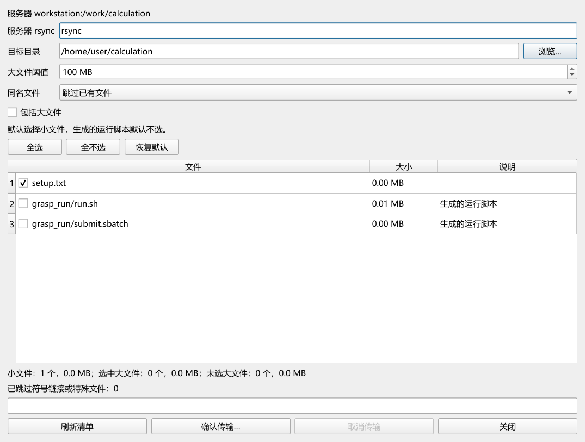
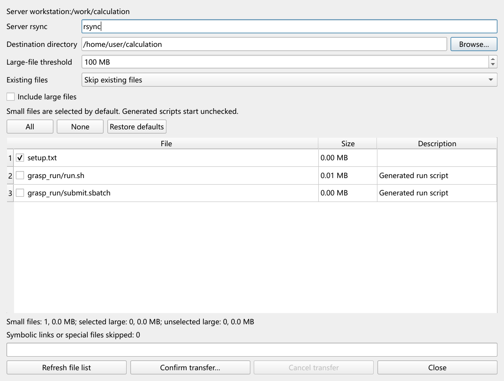
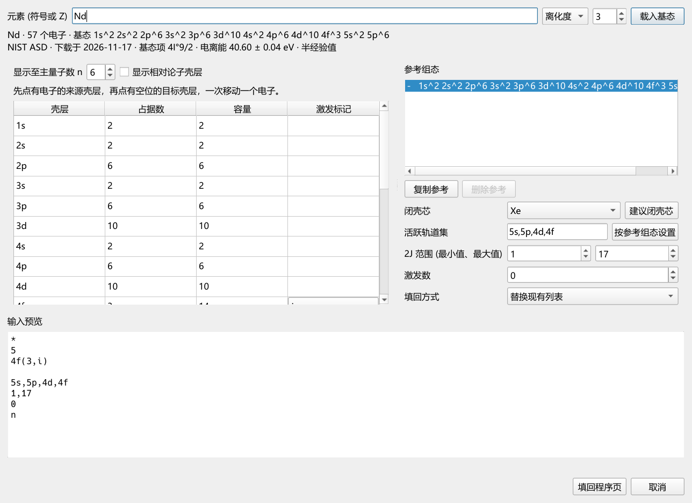
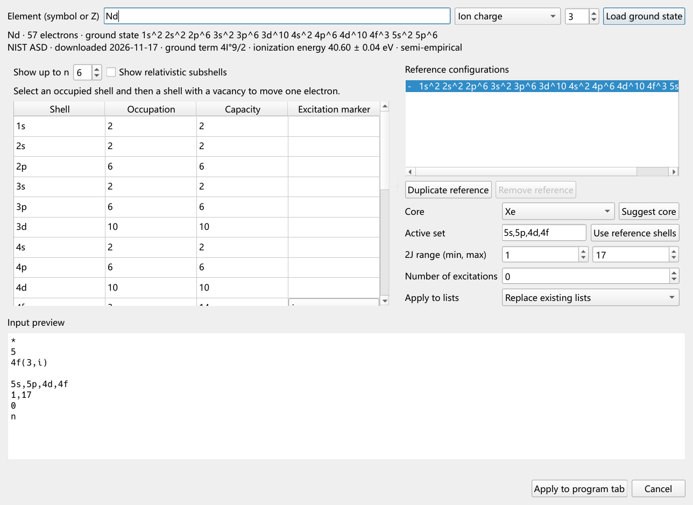
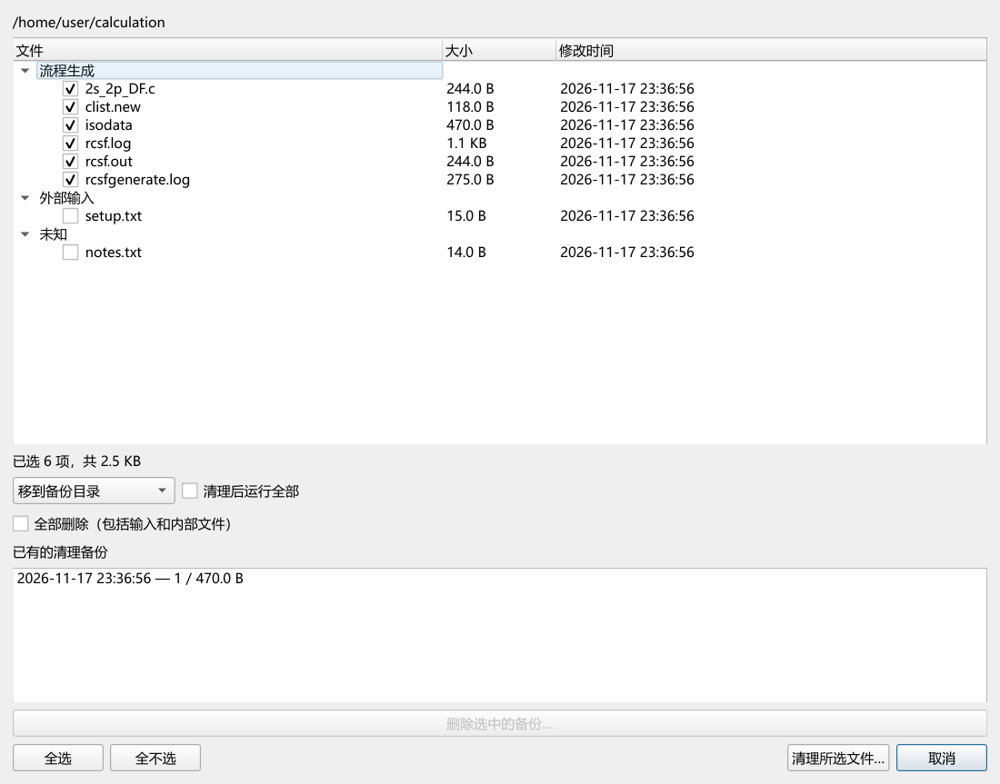
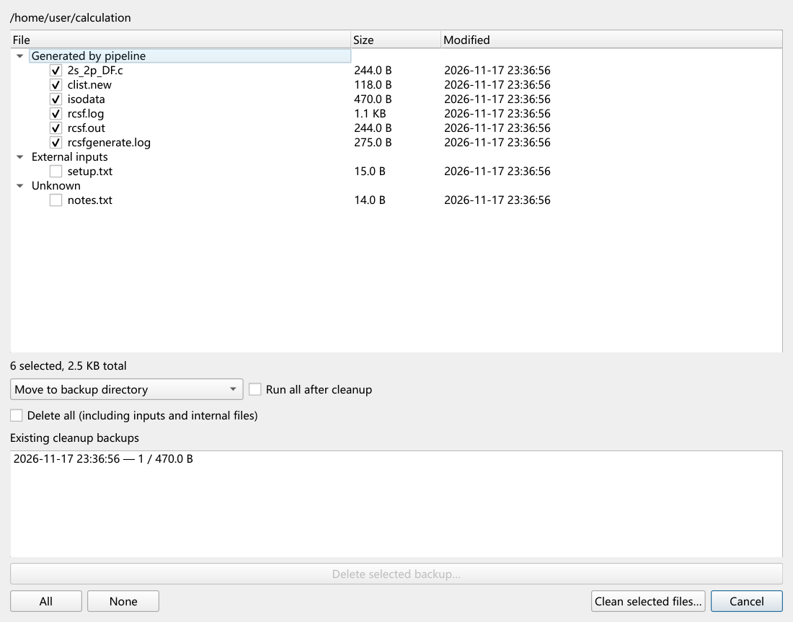
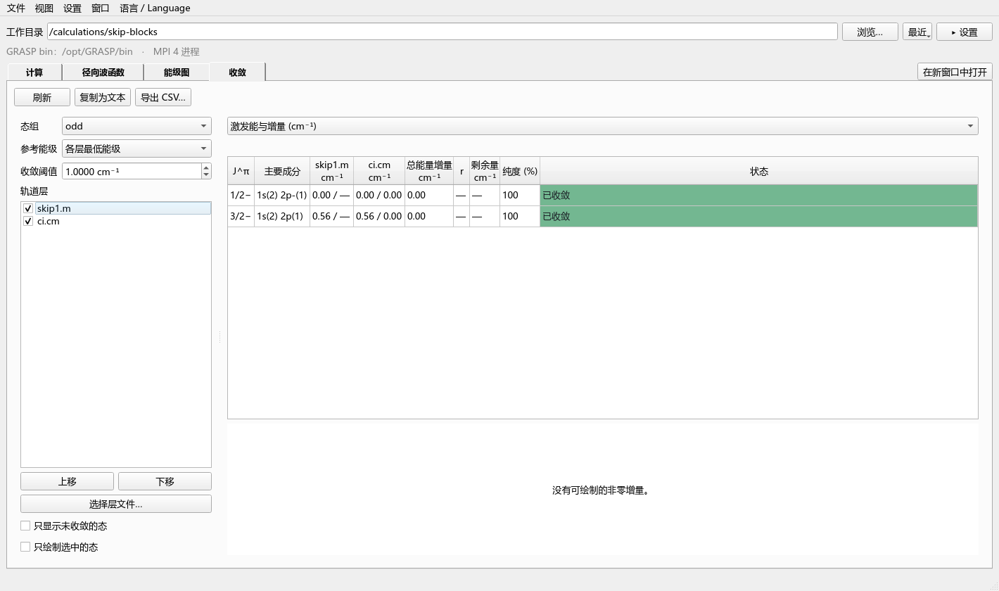
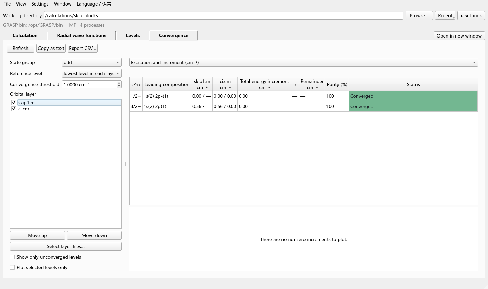
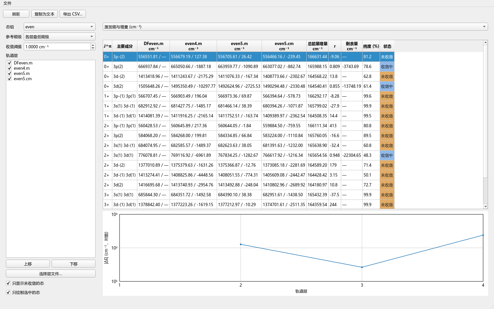
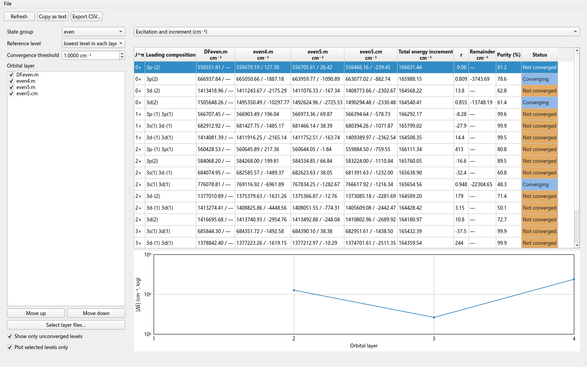

# Interface reference / 界面说明

A detailed description of the GUI: what each window, tab, menu and control does. The README only lists the
features; this file is the reference for users who want the details and for development (to know the interface
without starting it). Labels are given as *English (中文)*. Screenshots: `docs/images/` (made by
`tools/make_screenshots.py`). Keep this file up to date when the interface changes.

本文件详细说明界面的各个窗口、标签页、菜单和控件，供需要细节的用户和开发时参考 (不必启动程序即可了解界面)。
控件名写作“英文 (中文)”。界面改动时请同步更新本文件。

## Main window / 主窗口

```
┌ Menu: File  View  Settings  Window  Language ──────────────────────────────────────────┐
│ Working directory [__________________________] Browse… Recent▾ ▸Settings     │
│ GRASP programs (bin directory): /opt/grasp/bin · serial          (summary; ▾Settings expands it)  │
│ ┌ Calculation ┬ Radial wave functions ┬ Levels ┐          Open in new window │
│ │  tab contents                                                              │
│ └───────────────────────────────────────────────────────────────────────────┘│
│ status bar                                                                   │
└──────────────────────────────────────────────────────────────────────────────┘
```

* **Working directory (工作目录)**: edit + *Browse… (浏览…)* + *Recent (最近)* menu (its first item, *Open another
  directory… (打开其他目录…)*, opens a folder dialog). Changing it saves the previous session when needed,
  loads the new one's, and refreshes the viewers. On start the last directory is opened.
* **Settings (设置)** toggle: collapsed it shows a one-line summary (`GRASP programs (bin directory): … · serial` / `MPI n processes`);
  expanded: *GRASP programs (bin directory) (GRASP 程序目录 (bin))* + *Browse…*, *MPI processes (MPI 进程数)*, *mpirun command
  (mpirun 命令)*, *MPI_TMP*, *Lower priority of calculations (nice) (降低计算进程优先级)*. With more than one process
  `rangular`, `rmcdhf`, `rci`, `rbiotransform`, `rtransition` run as `mpirun -np N <prog>_mpi`. The collapsed state
  is remembered. For a new user, the process count defaults to `min(physical cores, 4)` when the configured
  MPI launcher and the MPI versions of rangular, rmcdhf, rci, rbiotransform and rtransition can be found
  through the normal GRASP programs directory or PATH lookup;
  otherwise it defaults to 1. Physical cores come from Linux CPU topology or macOS `hw.physicalcpu`, with
  a fallback of half the logical cores (at least 1). The initial value is saved immediately. Editing or browsing
  for the bin directory or editing the launcher recalculates the automatic default, with a status message
  when it changes. Counts entered by hand or loaded from a parameter file are retained. Older saved counts
  with no source indicator are treated as user choices. The input maximum
  remains the logical core count. Its tooltip explains that hyperthreading offers little benefit for GRASP.
  初始值立即保存。编辑或浏览选择 GRASP 程序目录 (bin)、编辑 mpirun 命令后，自动默认值重新计算，数值改变时状态栏提示一次。
  手动输入、载入参数文件指定的进程数，以及没有来源标记的旧设置均保留。
  [English screenshot](images/en_mpi_default.png) / [中文截图](images/zh_mpi_default.png)。
* **GRASP programs directory lookup**: `$GRASP_BINDIR` → last used → directory of `rmcdhf` on `PATH` → `../bin` of the program.
* **Tabs (标签页)**: *Calculation (计算)*, *Radial wave functions (径向波函数)*, *Levels (能级图)*; bold labels.
  The viewer tabs show the working directory and refresh after a run finishes. *Open in new window (在新窗口中打开)*
  (corner button, viewer tabs only) opens the current viewer in a separate window with its own directory bar
  (*Directory (目录)*) and a *File* menu (*Open directory…*, recent directories, *Close*) — e.g. to compare two
  calculations or to see a viewer next to the calculation tab.
* **Drag and drop**: directories and files dropped on a viewer open there (a mixing file → Levels, a `.w` file →
  Radial wave functions, only that file checked).
* **Status bar (状态栏)**: messages of the current tab only (background viewers do not overwrite it).
* **Closing** while a program runs asks for confirmation and terminates the whole process group.
* **Splitters (分隔条)**: wide handles with five dots, highlighted under the mouse.
* On Wayland the window frames use a blue-grey colour so dialogs are distinguishable from the main window.

### Menus / 菜单

| Menu | Items |
|---|---|
| *File (文件)* | *Import example… (导入示例…)*, *Import configuration file… (导入配置文件…)*, *Export configuration… (导出配置…)* — *Save parameters… (保存参数…)*, *Load parameters… (载入参数…)* — *Export pipeline as shell script… (导出流程为 shell 脚本…)*, *Export Slurm job script… (导出 Slurm 作业脚本…)* — *Open working directory… (打开工作目录…)* (Ctrl+O), *Recent working directories (最近的工作目录)* — *Quit (退出)* |
| *View (视图)* | *Larger font (放大字体)* Ctrl++ / Ctrl+=, *Smaller font (缩小字体)* Ctrl+−, *Default font size (默认字体大小)* Ctrl+0 — the three tabs, Ctrl+1/2/3. The font size is remembered; changing it rebuilds the interface (parameters, pipeline and output are kept). |
| *Window (窗口)* | *Open Radial wave functions / Levels in new window (在新窗口中打开…)* |
| *Settings (设置)* | *Allow AI agents via MCP (允许 AI agent 通过 MCP 使用本程序)*: checkable, off by default. Enabling shows a selectable explanation and Claude/Codex/Gemini client configurations; disabling rejects subsequent MCP tools, while background runs continue. 设置项默认关闭；勾选后弹出说明和可复制配置，取消后后台计算继续。See [MCP](MCP.md). |
| *Language / 语言* | 中文, English (rebuilds the interface; remembered) |

On macOS, Qt maps the documented Ctrl shortcuts to Command. Quit is in the system application menu.
macOS 上由 Qt 将文档中的 Ctrl 快捷键映射为 Command，退出操作位于系统应用菜单。

### External session changes / 外部记录修改

Before saving and on focus return, the calculation panel checks whether another program changed its
workdir record. A dialog shows the same change summary as the configuration update preview. **Load new
record (载入新的记录)** is the default and does not start new steps. **Keep my changes (保留我的修改)**
requires another confirmation before overwriting. Cancel leaves the record untouched. A write error is
reported; a read-only viewer can still close, while starting a run requires a saved record.

保存之前和窗口重新获得焦点时，计算页检查工作目录记录。外部修改会显示与更新预览相同的摘要；
默认载入新记录，新增步骤不自动运行；保留自己的修改须再次确认覆盖。取消不写入。保存失败会提示，
只读查看仍可关闭；开始计算前必须保存成功。

When a workdir record contains an unrecognized choice, the Calculation tab opens using the current default
and lists the affected steps or form fields and the original values. Shared configuration imports reject
unknown choices before installation.
工作目录记录含未知选项时仍可打开，计算页使用当前默认值并列出受影响的步骤或表单字段及原值。
导入共享配置时则在写入前拒绝未知选项。

While MCP is enabled, opening a calculation with `started_by: "mcp"` shows **[This calculation was
started by an MCP agent] ([此计算由 MCP agent 启动])** in the output, including after completion.
With MCP disabled, the toggle is the only agent-related interface item.
MCP 打开时，打开该来源的计算会在输出区显示来源；关闭时不显示 agent 提示，只有菜单开关。

### Connect to server / 连接服务器

**File → Connect to server… (文件 → 连接服务器…)** opens an SSH dialog with the SSH host, server type,
working directory on server and optional GRASP GUI server program path. Double-click directories to browse
and choose **Open this working directory**. Host-specific executable/directory preferences persist;
credentials do not.
Aliases for the same effective SSH user, host and port share settings. If an alias resolves to a different
saved host, the connection dialog applies that host's settings and shows its connection identity.
[Connection identity (English)](images/en_server_profile_identity.png) / [连接标识](images/zh_server_profile_identity.png).
**Server type (服务器类型)** selects Workstation (existing background execution) or Slurm cluster (batch submission,
scheduler state and cancellation); it is saved per host. Unclassified profiles require an explicit choice; the dialog
explains that login nodes should not run calculations directly. Slurm needs
a supporting server build; selecting it against an older build asks the user to update instead of running directly.
Errors show the server diagnostic and manual installation guidance. Password/verification-code
prompts use OpenSSH ASKPASS; old OpenSSH supports keys only. First-contact host-key confirmation shows the full
prompt/fingerprint with a visible input field and a verification reminder; passwords remain hidden. Hardware-key
notifications have no input or reply and close when ssh finishes the operation. Details and installation: [REMOTE.md](REMOTE.md).

The connection status and server workspace show the GRASP programs directory and its source. If GRASP
is missing, **Settings…** opens server run settings. Slurm reports describe the login node.
[Connection dialog (English)](images/en_connect_grasp.png) / [连接对话框](images/zh_connect_grasp.png).

The main window has one permanent **Local** workspace followed by the server directories you open.
Each server tab displays the full directory, server type and connection state above its three pages.
Enter a path in **Working directory on server**, or choose **Browse…**, **Siblings**, or **Recent**. The tab keeps
its SSH session and current page. Switching uses the same draft and transfer prompts as closing a tab.
An already open target is activated without changing the current directory of the original tab.
[Directory bar (English)](images/en_server_directory_switch.png) / [目录栏](images/zh_server_directory_switch.png).
Aliases that resolve to the same SSH user, host and port reuse an open tab for that directory.
**Ctrl+PgUp / Ctrl+PgDn** switch workspaces. **Ctrl+1–3** switch pages in the active workspace, and **Ctrl+4**
opens Convergence in the Local workspace. Local directory, import, export and parameter commands are disabled
while a server workspace is active. Changing the language or font size keeps open workspaces, connections,
reads and transfers. At startup only the saved Local page opens. Open a recent server directory explicitly
from the connection dialog.
With a server that supports writing (`workdir_write_v1`), the Calculation page uses the same program pages, pipeline
list and input preview as the Local workspace. **Check input files** asks the server to check its directory. Edits are
kept as a local draft, and the tab shows **●** while a draft exists. **Save to server…** previews the changes,
confirms custom commands separately and asks a final question that defaults to No. If the server pipeline changed or
a calculation is running, saving is refused and the draft is kept. The **Draft** menu can export it as a
configuration or reload the server pipeline (discarding the draft). There is no forced overwrite. A lost reply is
never resent: the client reads the server pipeline and compares revisions and fingerprints. Running asks you to
save the draft first. When reopening a directory with a draft, choose **Restore draft** or **Discard draft**.
Closing a tab, or quitting with drafts, asks for each one: **Save to server**, **Keep draft** (default) or
**Discard draft**. A disconnected tab keeps its draft and shows **Reconnect**. Older servers stay read-only with
an update hint. You can select a pipeline step to inspect parameters/input, run all/from selection, stop, refresh,
and follow pushed logs. Custom commands require confirmation. Logging-out policies may require choosing user scope,
Slurm export or explicit normal startup. Radial and level tabs reuse the existing viewers with remote data;
levels/compositions and coarse/fine curves appear progressively. Hover, selection, zoom and pan use cached data.
Load more components explicitly requests up to 500 items. Remote transitions display existing results; drawing a
pair never starts a new transition calculation. Diagram marks are temporary. Export CSV/figures locally;
original GRASP transition-file export is unavailable because raw data stays on the server. **Window** opens extra viewers sharing
the workspace connection. **Server actions → Reconnect** retries the connection when needed.
Results summary on the remote Levels tab uses the same dialog, with server-generated text and server-only run
state. Changing sections/level count requests a new summary. The dialog title shows the source; save chooses a
local file, starting in the desktop home directory. Cancel/older responses do not alter the clipboard or preview.
Closing a server tab closes its extra viewers and connection. A running server calculation continues.
If a file transfer is active, closing the tab asks whether to cancel it and defaults to No.
[English screenshot](images/en_server_workspaces.png) / [中文截图](images/zh_server_workspaces.png).

Workstation runs always open **Server run settings**, including runs after creation/upload and selected ranges.
The shared RunSettings fields show the server's GRASP programs (bin directory), process count, mpirun, MPI_TMP and nice.
An explicit programs directory saved on the desktop for this host takes precedence over server `GRASP_BINDIR`
and the directory of `rmcdhf` on `PATH`. The dialog preserves the saved field, including a blank value.
Checks run on opening, on **Check**,
and automatically before confirmation if values changed. Missing programs (including MPI variants/launcher)
and input preflight are shown; missing programs default to Cancel but allow explicit continuation.
Confirming saves only this host's desktop preferences. **Server actions → Server run settings…** also checks/saves without
starting a calculation. Older servers show read-only settings and an update instruction; their run requests remain
unchanged. Slurm continues to use its resource dialog. [中文截图](images/zh_server_grasp_settings.png) /
[English screenshot](images/en_server_grasp_settings.png).

If saved host settings become invalid, upload previews warn and check against server defaults instead, so a moved
bin directory does not block uploading. Run confirmation still validates settings strictly. An empty bin field
uses automatic discovery on the server for both the run check and startup.

For Slurm, **Submit Slurm job (提交 Slurm 作业)** reviews resource settings and asks for default-No confirmation.
The state shows the job ID and scheduler state; pending/running/unknown jobs disable submission. Stop uses
scancel only after verifying the saved job identity. The log belongs to that submission and reopens on a new
desktop connection. Missing queue/accounting information stays Unknown; it never becomes Completed merely
because the login-node process is absent. Resource settings persist per host; job identity persists on the server.
Lost submission replies recover by the saved queue comment. When accounting is unavailable after leaving the
queue, an atomic EXIT marker may establish script exit (`BATCH_EXITED`). After successful scancel,
a saved cancellation request plus a 130/143 exit marker displays Cancelled without accounting;
other failures and successful completion retain their own states. The request alone is not a terminal result.
Unknown/malformed records expose **I have checked; clear this job record…**: default-No confirmation,
a fresh server queue check and revision check,
then archival, with logs/scripts retained. Clearing does not cancel a job or establish success. Failed checks leave
the record unchanged. Valid records copied from a different directory are ignored in the copy.
选择“工作站”沿用后台直跑；选择“Slurm 集群”后通过资源设置及默认否确认提交 sbatch，按作业 ID 查询调度状态，
停止调用 scancel。排队、运行或状态未知时禁止重复提交；更换电脑或登录节点后，打开同一集群的原目录可恢复状态和日志。
类型和资源偏好按主机保存在本机，作业记录保存在服务器。调度状态不表示每步物理计算均成功。
**Edit locally… (在本机编辑…)** fetches the shared pipeline and revision into a local working directory, defaulting
to the same `~/grasp_calcs/remote/<host>/<directory>/` location as downloads. An unrelated nonempty local directory
is refused. Re-fetching the same copy asks default-No before replacing pipeline edits; local input conflicts remain.
The main window opens its original Calculation tab, with a persistent Server copy host:/path label and title.
Old servers without `workdir_write_v1` show an update instruction and receive no write requests.
远程“在本机编辑…”取出流程、附带小输入和修订号，切换到本机工作区的计算页编辑。
无作业号时按队列 comment 找回；离队且无记账时可用 EXIT 标记判定脚本退出。未知/损坏状态显示“我已核对，清除此作业记录…”，
默认否确认后由服务器重查队列和记录修订号，通过后归档原记录，保留日志与脚本。清除不取消任务，也不代表计算成功。
路径不匹配的有效记录不属于当前目录，不影响副本使用。新连接提示说明集群登录节点不宜直接运行计算。

“连接服务器”对话框可选 SSH 别名或手输 user@host、设置程序完整路径、浏览目录；成功使用目录后保存每台主机的
程序位置与目录，不保存密码。连接失败显示原始诊断和手动安装提示。
连接标识（SSH 用户、主机和端口）相同的别名共用主机设置。别名实际指向另一个已保存的主机时，
连接对话框采用那个主机的设置，并显示生效的连接标识。
主窗口保留一个不可关闭的本机工作区，已打开的服务器目录
各占一个标签。服务器标签顶部显示完整路径、服务器类型和连接状态。SSH 别名解析到同一用户、主机和端口时，同一目录复用标签。
在“服务器上的工作目录”栏输入路径，或用“浏览…”、“同级”、“最近”切换工作目录。切换沿用连接并保留当前页，
草稿和传输按关闭标签时的规则确认。
目标已经打开时激活对应标签，原标签仍在原目录。
Ctrl+PgUp / Ctrl+PgDn 切换工作区，Ctrl+1–3 切换当前工作区的页面，Ctrl+4 在本机打开收敛页。服务器工作区激活时，
本机目录、导入导出和参数菜单禁用。切换语言或字号会保留工作区、连接、读取和传输。启动时恢复本机页面，最近使用的服务器上的工作目录
可通过连接对话框手动打开。服务器工作区及独立查看器显示服务器来源。服务器支持写入 (`workdir_write_v1`) 时，计算页使用与本机相同的
程序页、流程列表和输入预览，“检查输入文件”由服务器按服务器上的工作目录检查。修改先保存为本机草稿，有草稿时标签显示 ●。
“保存到服务器…”先预览差异，自定义命令单独确认，最终确认默认为“否”。服务器流程已改变或有计算正在运行时拒绝写入，
草稿保留；“草稿”菜单可导出草稿为配置或重新读取服务器流程 (放弃草稿)，不提供强制覆盖。失去回答时不重发，读取服务器流程
按修订号和指纹核对。运行前先要求保存草稿。重新打开有草稿的目录时选择“恢复草稿 / 放弃草稿”；关闭标签或退出程序时逐个选择
“保存到服务器 / 保留草稿 / 放弃草稿”，默认保留草稿。断线时草稿保留，标签显示“重新连接”。旧服务器端只读并提示更新。

连接对话框显示 SSH 主机、服务器类型和服务器上的工作目录。GRASP GUI 服务器版程序路径可留空自动查找。连接后自动显示 GRASP 程序目录和来源，未找到时点“设置…”打开服务器运行设置。Slurm 的检查只代表登录节点。

可运行、停止和跟踪日志，自定义命令须确认。会受退出登录清理影响时默认取消，
用户可选 scope、导出 Slurm 或明确照常启动。能级/组成、粗/细曲线渐进显示；选中、悬停、缩放和平移使用缓存，
“读取更多组成”才补取数据。远程跃迁页只读已有结果，图上标记不写文件。“窗口”菜单可开共享连接的查看器，“服务器操作”菜单可重新连接。
远程“结果摘要…”由服务器读流程、状态并生成文本；勾选/能级数改变后重新请求，复制与本机保存沿用同一对话框。
标题显示服务器来源，保存从本机家目录开始选择；不使用桌面会话历史，不在桌面读取服务器上的工作目录，取消或旧回答不改变剪贴板。
关闭服务器标签会关闭这些查看器和连接，后台计算继续。传输中关闭时询问是否取消传输，默认否。完整协议、缓存/重连限制见 [REMOTE.md](REMOTE.md)。

工作站每次运行（含新建后运行、上传后运行和选定范围）先显示“服务器运行设置”，复用本机的路径、进程数、
mpirun、MPI_TMP 和 nice 控件。优先使用桌面为该主机保存的非空程序目录，再查 `GRASP_BINDIR` 和 `PATH`；
对话框原样显示已保存的字段。打开时、点“检查”时，
以及修改后确认前均在服务器检查，显示缺少的程序（包括 MPI 程序和启动器）和输入预检。缺少程序时默认取消，
仍可明确继续。确认只保存桌面端的该主机偏好；“服务器操作 → 服务器运行设置…”可单独检查、保存而不启动。
旧服务器只读显示并提示更新，运行请求不增加参数；Slurm 仍用资源设置对话框。
按主机保存的运行设置失效时，上传预览提示原因并改用服务器默认值检查，不阻断上传；运行时仍严格校验。
bin 留空表示自动查找，服务器预检和启动使用相同的目录解析规则。
上传警告截图：[中文](images/zh_upload_run_settings_warning.png) / [English](images/en_upload_run_settings_warning.png)。

The workspace's **Server actions** menu offers **Download to this computer…**, **Upload from this computer…**
and **Upload local directory…**. The transfer dialog lists all regular files and sizes in decimal MB, excludes symbolic
links/special files and defaults to selecting files no larger than 100 MB each (decimal MB). The threshold and
server rsync path are saved per host. Changing the threshold resets the selection; large files need individual
selection or Include large files. Confirmation separately counts selected small, selected large and unselected
large files. Skip existing files is the default, with Resume / verify and Overwrite alternatives. The background
progress shows speed and remaining time, and can be cancelled; partial data is kept for a later resume.
Transfer windows are non-modal, so analysis and the main window remain usable. Closing a transfer window
while it is busy asks whether to cancel, with No as the default; declining keeps it open and transferring. Closing
a server workspace also asks before cancelling active transfers. The default download location is `~/grasp_calcs/remote/<host>/<directory>/`.

工作区的“服务器操作”菜单提供下载、上传文件和上传目录；清单列出全部普通文件及十进制 MB 大小，跳过符号链接及特殊文件。
单个文件大于 100 MB 默认不勾选，可逐个勾选或使用“包括大文件”；阈值按主机保存，修改后重置勾选。
确认时分别列出小文件、选中大文件和未选大文件的数量/大小；同名文件默认跳过，也可续传/校验或覆盖。
传输窗口为非模态，传输时仍可操作远程分析和主窗口；进度、速度、剩余时间同时显示在传输窗口和远程状态栏。
传输中关闭传输窗口会询问是否取消，默认否；拒绝时窗口保持打开，传输继续。取消保留部分数据。
传输中关闭工作区也要确认取消。下载目录可自行选择。

The connection dialog also has **Install / update GRASP GUI server…** and **Remove from server…**. They show the host,
bundled version/size, editable installation root, checks and exact paths before a default-No confirmation.
Transfer progress and Cancel are available; returning from installation verifies the server and saves its path.
Development or self-built binaries without a bundle disable the installation button with a clear message; removal remains available.
Only older compatible server versions offer an update, which can be declined. Authentication, host-key and
network failures remain in the status area and do not open the installer.
“连接服务器”另有安装/更新与移除入口：先检查并列出主机、版本、大小、目录、链接及服务器检查结果，
默认不确认；可取消传输。无捆绑包时安装按钮禁用，移除仍可用；只对较旧服务器提示升级，认证和网络错误不弹安装框。安装成功核验后保存路径并重新连接。移除只处理列出的本程序文件，计算结果保留。

### Command line / 命令行

```
grasp_gui [DIR]            main window (default: last working directory)
grasp_gui levels [DIR]     open on the Levels tab (default: current directory)
grasp_gui wfn [DIR]        open on the Radial wave functions tab
grasp_gui FILE             open the tab for this file by content, only this file checked
                           (.m/.cm → Levels, .w → Radial wave functions); unrecognised file → exit code 2
--lang zh|en               interface language (remembered)

grasp_gui check CONFIG.json             check a shared configuration (exit code 1 if it cannot be imported)
grasp_gui script CONFIG.json [--bindir DIR] [--mpi "mpirun -np N"]
                                        print the shell script of its pipeline (runs in the current directory)
grasp_gui script WORKDIR                rebuild and print the paths of the work-directory scripts
grasp_gui steps                         reference of all program tabs and fields (Markdown, = docs/STEPS.md)
grasp_gui reference FILE.cm …           level energies of mixing coefficient files as "reference" JSON
```

`check`, `script`, `steps` and `reference` open no window; `python3 grasp_config.py …` does the same from the
sources. They are meant for scripts and AI agents ([AGENT_SPEC.md](AGENT_SPEC.md)).

A symbolic link named `grasp_levels` / `grasp_wfn` behaves like `levels` / `wfn`.

## Calculation tab / 计算页

```
┌ Setup ┬ SCF & CI ┬ Properties & transitions ┬ Results & tools ┐  State group [odd][even] Copy to even
│ rangular·odd ┬ rwfnestimate·odd ┬ rmcdhf·odd ┬ rsave·odd ┬ rci·odd       │
│  description of the program                                             │
│  form fields (label, editor, hint)                                      │
├ Preview input · ▶ Run this program · Add to pipeline ↓ ········ ■ Stop ─┤
│ ┌ Pipeline ┐            │ Input preview      │ Program output  List files Clear │
│ │ 1. rnucleus  ▶Run all  │ rmcdhf <<'EOF'     │  dark terminal-style output      │
│ │ 2. …         Edit …    │ …                  │                                  │
└─────────────────────────────────────────────────────────────────────────┘
```

* **Program tabs**, two levels (top: group, bottom: program):
  * *Setup (准备)*: `rnucleus`, `rcsfgenerate`, `rcsfinteract`, `rcsfsplit`, `rcsfzerofirst`
  * *SCF & CI (自洽场与 CI)*: `rangular`, `rwfnestimate`, `rmcdhf`, `rsave`, `rci`
  * *Properties & transitions (性质与跃迁)*: `rhfs` (optionally followed by `rhfs_lsj`), `rhfszeeman95`, `ris4`,
    `rbiotransform`, `rtransition`
  * *Results & tools (结果与工具)*: `jj2lsj`, `Coupling`, `rlevels`, `rtablevels`, `rtabtrans1`, `rtabtrans2`, `rmixextract`, `rmixaccumulate`, `rtabhfs`, `rasfsplit`, *Custom (自定义)*
    (any program with hand-written input)
* **Forms**: one per program, generated from the field definitions in `grasp_core.py` (description line, fields
  with hints at the right). Inputs follow each program's default-settings question order; they reproduce the inputs
  of the manual's test cases (`grasptest/` case1–4, example1–5, 8, 9) except non-default `jj2lsj` runs (use
  *Custom*). `rcsfgenerate` has several CSF lists (*+ Add list*, *− Delete current list*, *Reference configurations
  (one per line)*). `rmcdhf` can use the in-memory version `rmcdhf_mem` / `rmcdhf_mem_mpi`.
* **rcsfgenerate user orbital order / 自定义轨道顺序**. Select `u` (*user*) to edit *Orbital order*.
  Enter nonrelativistic orbitals such as `2p,2s,1s`, separated by commas or newlines. Entries must be unique
  and satisfy `n ≤ 15` and `l < n`. Preview shows both the file-writing action and stdin. Running the step
  writes `clist.ref` in the working directory before launching GRASP. GRASP appends unlisted orbitals in default order.

  在 *轨道排序* 中选择 `u`（用户指定）后可编辑 *轨道顺序*。输入非相对论轨道，例如 `2p,2s,1s`，
  可用逗号或换行分隔。轨道不重复，并满足 `n ≤ 15` 和 `l < n`。预览同时显示写文件动作和交互回答。
  运行该步时先在工作目录写出 `clist.ref`，再启动 GRASP。GRASP 将未列出的轨道按默认顺序接在后面。
* **rmcdhf NSIC**: *Modify NSIC (修改 NSIC)* enables a non-negative count of extra first-cycle orbital improvements; unchecked uses the program default.
  EOL defaults: `(NW-NFIX)/4` serial, `4+(NW-NFIX)/4` MPI, or 0 with varied correlation orbitals; AL: `2+(NW-NFIX)/4` (integer division).
  The page description explains the defaults; older configurations import with this option unchecked and no warning.
* **Levels per symmetry block / 各对称块能级**. In `rmcdhf` and `rci`, enter one line per block in the order in the
  CSF file. A blank line or `-` skips a block. Use `-` to skip a final block because trailing blank lines are ignored.
  Select levels in at least one block. Input checks and script export compare the row count with an existing
  CSF file when the selected steps will use that file. The application also checks the CSF immediately before
  launching either program, including when an earlier step in the same run generated it.

  在 `rmcdhf` 和 `rci` 中按 CSF 文件的块顺序填写，每块一行。空行或 `-` 表示跳过。末尾的空行会被忽略，跳过末块时请写 `-`。
  至少在一个块中选择能级。预检与导出脚本时，若所选步骤将使用现有的 CSF 文件，会核对填写的行数。
  程序启动前也会核对，包括本次运行中由前序步骤生成的 CSF 文件。
* **rhfszeeman95**: default-settings mode only. *State name (态名称)* is an ASCII basename of at most 23 characters;
  *Mixing coefficients from CI (混合系数来自 CI 计算)* selects `.cm` rather than `.m`.
  *Compute off-diagonal matrix elements (计算非对角矩阵元)* is checked by default and additionally writes
  `name.(c)gjhfs`. All J blocks must belong to the same saved state and orbital set; no biorthogonal transformation
  is performed. Reads `isodata`, `name.c`, `name.w` and `name.(c)m`. The constants output `name.(c)h` shares its name
  with rhfs but includes an energy table: the later run overwrites the earlier output.
  *Save a copy of constants name.(c)h as (常数结果 name.(c)h 另存为)* copies the new constants after the run
  (empty = no copy); it does not back up the previous output or copy the matrix file.
  *Output log file (输出日志文件)* is optional. Parameters are separate for odd/even state groups.
  中文：本页只使用默认设置，非对角矩阵元默认勾选；不同 J 块须在同一态文件中、共用一组轨道。与 rhfs 共用常数文件名，
  后运行的覆盖先运行的；“另存为”只在运行后复制本次常数结果，不备份旧文件，也不复制矩阵文件。参数按态组保存。
* **Zero/first-order partition (零阶 / 一阶划分)**: `rcsfzerofirst` (*CSF list of the zero-order space*, *CSF list to
  partition*, *Save the result rcsf.out as*) puts the zero-order CSFs at the top of each block. `rangular` and `rci`
  have the check box *Zero/first-order partition: CSFs outside the zero-order space treated as first-order
  perturbations* with *CSF list of the zero-order space*: they then answer the non-default questions (`rangular`: `n`
  + ICCUT per block; `rci`: `n`, name, no restart, no speed-of-light change, `y`, ICCUT per block). The ICCUT of each
  block is the number of CSFs in that block of the zero-order list; the input holds the placeholder line
  `@ICCUT <zero list> <CSF list>`, which the run replaces by the numbers (checking that the J/parity blocks match, and
  1 < ICCUT < ncf for `rangular_mpi`); the preview and exported scripts compute them with `awk` in an unquoted
  here-document. `rmcdhf` needs no change. Configurations from 2.1.0 without these fields import without warnings
  (partition off).
* **CSF/ASF tools**: *rmixextract* extracts CSFs above an absolute-coefficient cutoff, either per state or across all states;
  *rmixaccumulate* retains a fraction of the squared coefficients. Both read `name.c` and `name.(c)m`, write `rcsf.out`,
  and can copy it to *Save rcsf.out as (结果 rcsf.out 保存为)*; extraction also writes `name.rmx`.
  *rtabhfs* reads 1–20 `name.(c)hlsj` files (one per line) from rhfs_lsj and writes `hfs.tex`; this source version supports HFS only.
  *rasfsplit* splits `.c` and available `.m`/`.cm` files into `name_evenN.*`/`name_oddN.*` and copies `.w`.
  Prerequisite: all blocks must share the same orbital set, otherwise the split `.w` files are meaningless.
  The form always answers `y` to the common-orbital question; there is no confirmation checkbox.
  The three single-state tools keep separate odd/even parameters; the multi-file HFS table is shared.
* **Other coupling schemes**: `jj2lsj` has *Write files for Coupling (写出 Coupling 需要的文件)*, with an optional
  `block: levels` selection (empty = all), composition print cutoff and backup of the original LSJ labels
  to `name.lsj.lbl_SAVE` **before** conversion. Enable this backup only after running default jj2lsj to create
  the complete `name.lsj.lbl`; the checkbox hint states this prerequisite.
  The external *Coupling* program ([compas/coupling](https://github.com/compas/coupling), separately installed) reads
  `name.lsj.c`/`name.lsj.j` and writes `name.coupN.*.lbl`/`.sum`. Select 1, 2 or 3 coupled shells and the shells to recouple;
  available label schemes depend on that count. *Use the selected scheme labels afterwards (结束后采用指定方案的标记)*
  optionally backs up the current `name.lsj.lbl` to **`name.lsj.lbl_LSJ`** before copying the chosen result there,
  ready for `rlevels`. This preserves the separate pre-conversion `.lsj.lbl_SAVE` even when both backups are
  enabled. The configuration key is `coupling`; the executable is `Coupling`. Parameters are per odd/even group.
  New examples `example2_coupling` and `example3_coupling` preserve the original examples; the Si VIII example generates
  partial labels only, without the manual's hand-edited repairs or a full recoupled energy table.
* **Built-in file steps**: save `rcsf.out` as `name.c`, copy a `.c` file to `rcsf.inp` before `rangular`, run
  `rsave` after `rmcdhf` (*rsave afterwards as*), copy `.c/.w` before `rci`.
* **State groups odd / even (态组)**: `rcsfgenerate`, `rcsfinteract`, `rcsfsplit`, `rcsfzerofirst`, `rangular`, `rwfnestimate`,
  `rmcdhf`, `rsave`, `rci`, `jj2lsj`, `rhfs`, `ris4` keep separate parameters per group (tab labels show
  `· odd`); file names such as `odd2.c` / `even2.c`, `outodd_rci` / `outeven_rci` correspond automatically. The
  other tabs are shared. *Copy to even/odd (rename files) (复制到 …（替换名称）)* copies the current group to the
  other one, replacing the group name in file names (asks first).
* **Buttons**: *Preview input (预览输入)* (shows the generated stdin in *Input preview*), *▶ Run this program
  (运行当前程序)*, *Add to pipeline ↓ (加入流程)*, *■ Stop (停止)*.
* **Pipeline (流程)**: list of steps; *▶ Run all (运行全部)* (stops at the first error), *▶ Run from selected
  (从选中开始)*, *Move up / Move down (上移 / 下移)*, *Edit (编辑)* (loads the selected step's parameters into its
  form, switching to its program tab and state group), *Update selected (更新所选)* (replaces the selected step by
  the current form; it must be the same program), *Show (查看)* (input preview of the step), *Remove (删除)*,
  *Clear (清空)*, *Export ▾ (导出)*: shell script / Slurm job script. Steps imported as commands have no form and
  cannot be edited. The buttons stand in one column, grouped (run; edit / update / show; move; remove / clear;
  export); when the pane is too low for one column they rearrange into two.
  Shift/Ctrl selects consecutive steps. *▶ Run from selected* starts at the first selected row;
  *▶ Run to selected (运行到选中)* runs from step 1 through the last selected row;
  *▶ Run selected steps (运行选中的步骤)* runs only that continuous span. Noncontiguous selection disables
  these three buttons with an explanatory tooltip; *Run all* ignores selection. Edit, update, show, move,
  remove and manual input checking still use the current row. Shell/Slurm exports still include all steps.
  Completion output and the persistent last-run caption identify partial runs as
  “Ran steps a–b (pipeline: n steps)”; later steps are not marked successful in the summary.
  流程支持 Shift/Ctrl 连续多选：“从选中开始”从选区首步到流程末尾；“运行到选中”从第 1 步到选区末步；
  “运行选中的步骤”只运行选区。不连续时禁用这三个按钮并说明原因，“运行全部”仍可用。
  编辑、更新、查看、移动、删除及手动检查仍作用于当前行；导出脚本仍包含整个流程。
  分段运行只预检该段，前置输出必须已经存在；结束后输出区和常驻提示写明“已运行第 a–b 步 (流程共 n 步)”。
  重新打开目录时按唯一连续标题序列恢复范围；标题无法唯一对应时保留原提示，不猜测范围。
  本机原有“运行全部 / 从选中开始”保留原行为：空流程且空闲时点击不操作，已有任务时点击显示运行中提示；
  “从选中开始”仅因不连续选区而禁用。两个新按钮在空流程或本机运行中禁用，并提供明确提示。
  分段失败、停止或意外结束时，本机和远程提示均使用流程中的步号，例如第 4–8 步中第二步出错显示第 5/27 步。
  The original local Run all/from selected buttons retain their click behavior: an empty idle pipeline is a no-op,
  and an active local run shows the existing warning. Noncontiguous selection disables Run from selected.
  The two new buttons explain why they are disabled for empty/busy pipelines. Partial failure, stop and unexpected
  termination captions use pipeline step numbers locally and remotely (e.g. step 5/27 within steps 4–8).
  Screenshots / 截图：[中文](images/zh_run_range.png) / [English](images/en_run_range.png).
* **Check input files (检查输入文件)**, next to *Preview input*: checks the pipeline from the selected step
  (or the current form if there is no pipeline). Starting a run also checks its selected steps, including
  *Update and run added steps*. Existing files and files declared as produced by earlier selected steps are
  accepted. Fixed intermediates and file copies are considered in order; `rsave` moves `rmix.out`, so it is
  unavailable afterwards. The angular-file check uses the same `.30` sentinel convention as the existing
  runner, including each MPI rank; it is not an integrity or physics check. Custom/undeclared steps are
  marked unchecked; a non-modal notice in program output reports their count on run. Missing files produce a step/filename report with similar names; **Run anyway (仍然运行吗？)**
  defaults to No. The same report includes invalid names/parameters with step, program, field, name and limit.
  Derived names are traced to the producer and identify the downstream step that cannot read them. Name/parameter
  issues always block the run, with no Run anyway option, even if files are also missing. Without issues the run
  check is silent; the manual button reports no missing inputs or name issues. It does not generate invalid stdin.
  “检查输入文件”检查从选中开始的流程；流程为空时检查当前表单。运行前也检查，包括更新后运行新增步骤。
  未声明依赖的步骤标为无法检查；缺失时列步骤、文件及相近文件名，默认取消，可选仍然运行。
  名称/参数问题与缺文件合在一份报告，列步号、程序、字段、名字及上限；派生名称追溯到写出它的步骤，并注明后续
  哪一步会失败。只要有名称或参数问题就禁止运行，不提供“仍然运行”，不会先生成错误输入再执行。
* **Input preview (输入预览)**: when the lower area is at least 1300 pixels wide it is a column of its own between the
  pipeline and the program output (the three widths are remembered); when narrower it is a tab next to *Pipeline*.
  It shows the command, the here-document with the program's stdin and the file actions, e.g.
  `rmcdhf <<'EOF' … EOF` followed by `rsave odd4`.
  The text follows the pipeline's current row (mouse, arrow keys or programmatic selection); with multiple
  selected steps it shows the current row. Automatic refresh leaves the Pipeline tab visible in narrow windows.
  For a pipeline-sourced preview, move/remove/clear refresh from the resulting current row, or clear it if
  there is none. List rebuilding preserves a form preview, including after Add to pipeline; it does not
  automatically select a newly added or neighboring step.
  Update selected immediately shows the updated step and opens the preview, as Show and double-click do.
  Preview input still opens a preview of the program form. Changing form fields alone does not refresh it.
  Changing the MPI process count or mpirun command regenerates the displayed source: either that pipeline row
  or the program form that supplied the preview. An invalid form keeps the previous text without a dialog.
  The source is temporary UI state and is not saved in the working-directory record.
  预览随流程当前行刷新（单击、方向键或程序设置当前行），多选时显示当前行；自动刷新只改文字，不切走“流程”标签。
  流程来源的预览在上移、下移、删除、清空后按新的当前行刷新；没有当前行时清空。表单来源的预览不受列表重建影响，
  “加入流程”后仍保留；不会自动选择新加入或相邻的步骤。“更新所选”后立即显示新输入并切到预览，
  与“查看”和双击一样。“预览输入”仍显示程序页表单并切到预览，单独修改表单参数不自动刷新。
  修改 MPI 进程数或 mpirun 命令时，按当前预览的来源（流程行或原程序页表单）重新生成；表单不合法时保留旧文字，
  不弹错误框。预览来源仅为临时界面状态，不写入工作目录记录。
* **Program output (程序输出)**: dark terminal-style pane, last 5000 lines (set a log file in the form for the full
  output); *Working directory (工作目录)* (update, restore record, clear directory; see below),
  *List files (查看文件)*, *Clear (清屏)*. Errors in red, step headers in blue.
* **Background runs (后台运行)**: every run (a program or the pipeline) is executed by a separate background process
  (`grasp_gui _run`); the tab shows its output live and *■ Stop* stops it. A permanent label at the right of the
  status bar shows *Running: step i/n title, this step h:mm:ss (运行中：第 i/n 步 …，本步 …)*, updated every second,
  plus *last output … ago (最后输出于 … 前)* when the programs have printed nothing for a minute or more (GRASP may be
  silent for hours in a long calculation). Messages of other tabs and menu hints do not replace it. The step is
  shown only there (no second status message). After the run the label keeps the result of the directory's last run,
  e.g. *Last run failed at step 3/7 rmcdhf (ended …) (上次运行在第 3/7 步 … 出错)*, also after reopening the
  directory; a failed or stopped run also ends the output with this line.
  * Quitting while a run is in progress asks *Continue in background (后台继续)* (default) / *Stop the run and quit
    (停止计算并退出)* / *Cancel (取消)*; without a run the program quits without asking. If the window disappears
    unexpectedly (ssh disconnected, crash), the run continues in the background.
  * Switching to another working directory leaves the run of the old one in the background (noted in the output).
  * Opening a directory whose run is still going reattaches: the output so far (up to 1 MB) is replayed, then live
    output follows; *Stop* works again. A run that ended while no window was attached is shown once: the end of its
    output and *\*\*\* The background run finished / was stopped (step i …) / failed at step i …*.
  * On machines with systemd-logind `KillUserProcesses=yes`, the end of the login session ends background runs too;
    see [below](#background-runs-and-logging-out--后台运行与退出登录-killuserprocesses).
  * Only one run per directory. If the directory's run is on another machine (e.g. another login node of a
    cluster), its output is read from the log file every 0.2 s and *Stop* explains that it can only be stopped there;
    starting a new run there asks first.
  * Files in the working directory: `.grasp_gui_run.json` (process, host, start / end, steps, current step, result),
    `.grasp_gui_run.log` (the whole output of the last run).
* **Session (工作目录记录)**: opening a directory restores its parameters, groups and pipeline from
  `<workdir>/.grasp_gui.json`. For a directory without a record, the first record is created by editing or
  clearing the pipeline, running, importing, or saving changed form or group parameters when switching
  groups or directories or closing the window. Inherited parameters, browsing results and switching tabs
  or groups by themselves do not create a record. Changing only run settings saves user preferences.
  *Save / Load parameters* write / read the same content as a JSON file elsewhere.

  工作目录已有记录时照常保存。没有记录时，编辑或清空流程、运行、导入会建立记录。修改表单或态组参数后，
  在切换态组、切换目录或关闭窗口时保存。沿用上个目录的参数、查看结果、切换标签页或仅切换态组不产生记录。
  只调整运行设置时保存到用户偏好。
* **Slurm job script (Slurm 作业脚本)** dialog: job name, partition, nodes, tasks, time, memory, modules, e-mail,
  extra `#SBATCH` lines (remembered). Upload the script with the inputs of the working directory and `sbatch` it.

### Run scripts in the working directory / 工作目录运行脚本

Saving a nonempty pipeline updates `grasp_run/run.sh` and `grasp_run/submit.sbatch` from `.grasp_gui.json`.
The script headers identify the record revision. Each step appears once with its primary inputs and outputs.
Unchanged scripts keep their modification times. On a generation error the record is still saved and the
warning appears in the calculation output and status bar. A same-named user file is preserved. When the pipeline
becomes empty, the app removes its own scripts and removes the directory if it is empty.

```sh
cd /path/to/calculation
sh grasp_run/run.sh
sh grasp_run/run.sh 4 6
sbatch grasp_run/submit.sbatch
sbatch grasp_run/submit.sbatch 4 6
```

Both commands accept an inclusive one-based range. `run.sh` finds its working directory relative to the script
and reports the failing step if a command exits with an error. It uses the GRASP program directory from the
machine that generated it. `submit.sbatch` uses the Slurm program directory saved in the record and expands
its home-directory notation on the cluster. Set `GRASP_RUN_BINDIR`, `GRASP_RUN_NP`, `GRASP_RUN_MPIRUN`, `GRASP_RUN_MPI_TMP`,
or `GRASP_RUN_NICE` in the environment to override settings. MPI launcher prefixes should use
`$GRASP_RUN_NP` for the process count. The GUI continues to use its existing background runner.

保存非空流程后，从 `.grasp_gui.json` 更新 `grasp_run/run.sh` 和 `grasp_run/submit.sbatch`。文件头标注记录修订号，
每步正文只出现一次，前面列出主要输入和输出。内容相同则保留修改时间。生成失败时记录照常保存，提示显示在计算输出和状态栏。
程序保留用户同名文件。流程为空时，只删除程序生成的脚本，目录变空才删除。

可以按上面的命令手动运行全部或指定连续步骤，起止编号从 1 开始且均包含。计算目录由 `run.sh` 的位置确定，某步命令失败时
显示步号后停止。`run.sh` 使用生成机器的默认 GRASP 路径。`submit.sbatch` 使用记录中的 Slurm 程序目录，在集群上展开
家目录写法。可用列出的环境变量覆盖路径。MPI 启动前缀用 `$GRASP_RUN_NP`
统一进程数；界面仍用原有后台运行方式。用 `grasp_gui script 工作目录` 手动重建脚本。只清理结果时保留 `grasp_run/`，
明确选择“全部删除”才可一并删除。上传和下载默认不勾选其中的文件。

| 中文 | English |
|---|---|
|  |  |

### Build configurations from a shell model / 从壳层模型构造组态

In **rcsfgenerate → Build from shell model…**, enter an element symbol or atomic number and either an ion
charge or an electron count, then load the ground state. The initial element comes from the rnucleus form.
To move one electron, click an occupied shell and then a shell with a vacancy. The relativistic view divides
the occupation into the smaller- and larger-`j` subshells for illustration. Duplicate a reference to explore a
different occupation. References with unlike parity generate separate lists.

Set an excitation marker on each occupied shell (`i`, `*`, or a minimum occupation). Choose the core, the
highest active `n` for each `l`, the 2J limits, and the number of excitations. A suggested core must be fully
occupied in every reference and leave at least one electron outside it. **Apply to program tab** fills the
existing fields after showing the exact GRASP input. **Append** keeps the original core so earlier lists
retain their meaning. Running a calculation still requires the regular run action.

在 **rcsfgenerate → 从壳层模型构造…** 输入元素符号或原子序数，再输入离化度或电子数，点击载入基态。初始元素取自
rnucleus 程序页。先点有电子的来源壳层，再点有空位的目标壳层，每次移动一个电子。相对论视图先填较小的 `j`，
只用于展示占据。复制参考后可构造其他占据。混合宇称会拆成独立列表。

为各壳层选择激发标记（`i`、`*` 或最少占据数），并选择闭壳芯、各 `l` 的最大活跃 `n`、2J 和激发数。建议的芯在所有
参考中均为满占据，且至少留一个芯外电子。“填回程序页”使用现有字段，确认前显示准确的 GRASP 输入。“追加”沿用现有闭壳芯，
以保留原列表含义。需要通过正常运行入口执行计算。

The offline snapshot contains 6019 element/charge rows from NIST ASD version 5.12, downloaded on 2026-11-17.
It stores ground-shell occupations, terms, and ionization energies where listed. Missing ground states use the
Madelung order (ascending `n+l`, then `n`) and are labeled **estimated**. An estimate supplies no energy or
term. **Settings → About GRASP GUI…** shows the data citation.

The ground term uses spectroscopic notation in plain text, such as `9D°2`. The ionization energy includes the published
uncertainty when available. Theoretical and semi-empirical values are labeled using the ASD table notes.

离线快照于 2026-11-17 下载自 NIST ASD 5.12，含 6019 个元素和离化度条目，保存该表给出的基态占据、项和电离能。
缺少基态数据时依次按 `n+l`、`n` 由低到高填充，界面标注“推算”，且不推算基态项和电离能。“设置 → 关于 GRASP GUI…”
显示引用。生成脚本为 `tools/make_shell_snapshot.py`。程序运行期间只读离线快照。

基态项按光谱学的纯文本写法显示，例如 `9D°2`。电离能附有表中提供的不确定度，理论值和半经验值按 ASD 表注标明。

[Source / 来源: NIST ground states and ionization energies](https://physics.nist.gov/PhysRefData/ASD/ionEnergy.html)
· [ASD table notes / 表注](https://physics.nist.gov/PhysRefData/ASD/Html/iehelp.html)
· [NIST ASD DOI](https://doi.org/10.18434/T4W30F)

| 中文 | English |
|---|---|
|  |  |

### Background runs and logging out / 后台运行与退出登录 (KillUserProcesses)

Background runs survive closing the window and an ssh disconnect on most systems. On a machine where systemd-logind
has `KillUserProcesses=yes`, however, everything started in a login session — the GUI, its background run and the GRASP
programs — is ended when **that session ends** (ssh disconnected, or logout from that session). Most common
distributions (RHEL / CentOS / Rocky, Debian, Ubuntu, Fedora) set `no`, but the systemd default is `yes` and
administrators may enable it. When it applies to the current session, the quit dialog says so.

后台运行在多数系统上可以挺过关窗和 ssh 断开。但如果机器上 systemd-logind 设置了 `KillUserProcesses=yes`，在一次登录中启动的
全部进程 (界面、后台运行进程和 GRASP 程序) 会在**这次登录结束** (ssh 断开或退出登录) 时被结束。常见发行版 (RHEL / CentOS /
Rocky、Debian、Ubuntu、Fedora) 默认是 `no`，但 systemd 本身的默认值是 `yes`，管理员也可能打开它。对当前登录有影响时，退出对话框会提示。

Check / 检查 (`b true` = enabled; a user listed in `KillExcludeUsers` is not affected / 列在其中的用户不受影响):

```bash
busctl get-property org.freedesktop.login1 /org/freedesktop/login1 org.freedesktop.login1.Manager KillUserProcesses
busctl get-property org.freedesktop.login1 /org/freedesktop/login1 org.freedesktop.login1.Manager KillExcludeUsers
```

Remedies / 解决办法:

1. Ask the administrator to set `KillUserProcesses=no` in `/etc/systemd/logind.conf` or to add you to
   `KillExcludeUsers`. 请管理员关闭该设置，或把你加入 `KillExcludeUsers`。
2. Without the administrator: keep your systemd user manager running after logout (lingering; may need permission)
   and start the GUI outside the login session, so that it and its background runs belong to the user manager:
   不需要管理员时：让 systemd 用户管理器在退出登录后继续运行 (lingering，可能需要权限)，并在登录会话之外启动界面，界面和它的
   后台运行进程就属于用户管理器，不随登录结束：

   ```bash
   loginctl enable-linger
   systemd-run --user --scope grasp_gui
   ```

   `loginctl show-user $USER -p Linger` shows `Linger=yes` when the first step worked. 第一步成功后显示 `Linger=yes`。
3. For long calculations on clusters, submit the pipeline as a Slurm job (*Export ▾ → Slurm job script*); login nodes
   often limit long-running processes anyway. 集群上的长时间计算请导出 Slurm 作业脚本提交；登录节点通常本来就限制长时间运行的进程。

### Import example / configuration (导入示例 / 导入配置)

Dialog *Import configuration (导入配置)*: an explanatory line at the top; left the list of examples (GRASP2018 manual:
example1–5, 8, 9, case1–4; case2 is C IV at Z=6, case3 Fe XV at Z=26; manual_csfs covers §§5.1–5.8, manual_zf covers §14.1) or, with *Open configuration file… (打开配置文件…)*, a file; right an information
pane: title, origin (*Example included with the program*), summary, *Estimated time (预计时间)*, *Package (程序包)*,
*Pipeline (流程)* (n steps), *Programs used (用到的程序)* (missing ones in the GRASP programs (bin directory) marked), attached
files, compatibility warnings, **custom commands** (orange, on a light background: *Custom* tab steps and steps
stored as commands — they can run any program), *Reference results (参考结果)* (energies of the mixing coefficient
files). Bottom: *Import into directory (导入到目录)* + *Browse…* (default `~/grasp_demos/<id>` for examples,
`~/grasp_calcs/<name>` for files; must be empty or new), *Import (导入)*, *Cancel*. Importing a file with custom
commands asks for confirmation. After import the GUI switches to that directory; *▶ Run all* computes it.

*From clipboard (从剪贴板读入)* beside *Open configuration file…* reads the normal CLIPBOARD (Ctrl+C),
not X11's mouse PRIMARY selection. It accepts one JSON object, optionally wrapped in a `json` or plain Markdown
code block. Preview, warnings, attached files and custom-command confirmation are the same as file import;
the source is shown as *Clipboard (剪贴板)*. *File → Import configuration file…* opens this dialog so either
source can be chosen. Clipboard imports suggest a directory under `~/grasp_calcs/` from the configuration id,
or its title when no id is present (sanitized as a file name, with a suffix if occupied). The shared text/file limit is 32 MiB; the existing attached-file limits still apply.

中文：从剪贴板读入支持纯 JSON 和 Markdown 代码块，使用 Ctrl+C 的剪贴板，不读鼠标选中的 PRIMARY。
读取后照常预览并确认自定义命令，来源显示“剪贴板”；默认目录优先用配置 id，没有时用标题，并清理路径字符、避开已有目录。
文件和文本采用相同检查和格式错误提示，文本总上限为 32 MiB。

新增示例：case2 为 C IV (Z=6)，case3 为 Fe XV (Z=26)，只计算所选元素；manual_csfs 为 §5.1–5.8 的 CSF 教学例，
只生成组态列表；manual_zf 为 §14.1 的 Fe XIII 零阶 / 一阶能量计算。[完整清单 / Full inventory](MANUAL_EXAMPLES.md)。

### Update an existing directory / 更新现有工作目录

The import dialog defaults to a new, empty directory. Check *Update current working directory (更新当前工作目录)*
to use the current directory, or open *Program output → Working directory → Update current directory from
configuration… (程序输出 → 工作目录 → 用配置更新当前目录…)*. Running directories cannot be updated or cleared.
The same *Working directory (工作目录)* menu also has *Open working directory… (打开工作目录…)* and *Recent working
directories (最近的工作目录)* for switching directories.
The update preview shows a copyable list of added, removed, moved and changed steps (field values before → after),
with other program-form changes listed separately. Steps are matched by content after filling defaults, so an
insertion keeps later steps unchanged. Attached files are added when absent, skipped when identical; conflicts show
a text diff and are kept unless checked. *Update only (只更新)* retains existing results and highlights the first
changed step. For an unchanged prefix followed by new steps, *Update and run added steps (更新并运行新增的步骤)* starts
at the first new step; overwriting existing inputs disables this shortcut so the required recomputation can be
reviewed first. Before updating, the original record is backed up as `.grasp_gui.json.bak-<timestamp>` (last five
retained). *Restore previous working-directory record (恢复上一次的工作目录记录)* restores parameters and pipeline,
retaining results, attached files and their input list. Restoring first backs up the current record, so restoring
twice returns to the state before the first restore; the confirmation explains this. Shared configuration and
session formats are unchanged.

导入默认写入新的空目录；勾选“更新当前工作目录”可改为原目录，也可在“程序输出 → 工作目录 → 用配置更新当前目录…”进入。
预览按内容比较流程，列出新增、删除、移动、各参数的前后值，其他程序页参数另列；摘要可复制。附带文件不存在则新增、相同则跳过，
冲突显示文本差异并默认保留，勾选才覆盖。“只更新”保留已有结果，并选中首个受影响的步骤；仅在末尾追加时可“更新并运行新增的步骤”，
覆盖旧输入时需先核对重算范围。每次更新前备份原记录，最多保留五份；“恢复上一次的工作目录记录”只恢复流程和参数，
保留结果、附带输入及其清单。恢复前也会备份当前记录，所以连续恢复两次会回到首次恢复前的状态，确认框会明确提示。
正在运行的目录禁止更新、恢复和清空。

### Clear a working directory / 清空工作目录

Open **Program output → Working directory → Clear working directory…**. Only files generated by the saved or
current pipeline are selected initially. The **External inputs** category includes attached inputs from
`.grasp_gui_inputs.json` and files read before a step creates them. Selecting one displays a warning.
Unrecognized files, including undeclared custom-command outputs, start unchecked. Internal files, including run
records, are hidden in this mode.

Cleanup recognizes serial and MPI angular coefficient files regardless of the current process count. It checks the
recorded MPI working directory, or the current setting if absent, and also checks the default `tmp_mpi` directory.

The default moves selected files to `.grasp_gui_cleaned/<timestamp>/` and keeps their relative paths.
Choose **Delete permanently** to free space. The dialog shows the directory, count, total size, and method before
asking for confirmation, with **No** selected by default. The backup list shows time, file count, and size.
Select a backup to delete it after confirmation. Cleanup refuses active background and Slurm runs, including
unconfirmed scheduler states. A failure during cleanup lists the processed and remaining items. Symbolic links
are handled as links. Mount points and special files cannot be cleaned.

**Run all after cleanup** enters the normal run workflow after successful cleanup. The last run label shows the
cleanup time if cleanup happened later. Permanent cleanup stores the time in an empty timestamped `.deleted`
directory under `.grasp_gui_cleaned/`. Ordinary cleanup preserves the pipeline and run records. Select
**Delete all (including inputs and internal files)** and type the directory name to use the original full deletion.
A directory without a work record requires separate confirmation. When the full deletion removes the record,
the visible pipeline clears and closing the window leaves the record absent.

计算页从 **程序输出 → 工作目录 → 清空工作目录…** 打开。初始只勾选流程生成的文件。附带输入和首次读取前尚未由流程生成的
文件归入“外部输入”，勾选时会提示重跑风险。未知文件（包括自定义命令未声明的输出）默认不勾选，内部文件和运行记录不显示。
清理识别串行和 MPI 角系数文件。MPI 目录优先使用工作记录的设置，缺少时使用当前设置，同时检查默认的 `tmp_mpi`。

默认将文件移到 `.grasp_gui_cleaned/<时间>/`，保持相对路径。要释放空间可选“直接删除”。最终确认列出目录、数量、大小
和方式，默认选“否”。备份列表显示时间、数量和大小，选中后可以确认删除。后台运行中或 Slurm 作业未结束、状态未知时
拒绝清理。中途出错时列出已处理和未处理项目。符号链接只处理链接本身，挂载点和特殊文件不可清理。

勾选“清理后运行全部”会在清理成功后进入正常运行流程。如果清理晚于上次运行，状态栏附上清理时间。永久删除只在备份
目录下留下带时间的空 `.deleted` 标记目录。常规清理保留流程和运行记录。“全部删除”仍可用，包含输入与内部文件并要求
输入目录名。没有记录的目录需另行确认。全部删除若移除了记录，界面流程随之清空，关闭窗口也不会重新写出记录。

| 中文 | English |
|---|---|
|  |  |

### Export configuration (导出配置)

Dialog: explanation (parameters of every step, no results, no machine settings), *Title* (required), *Summary*,
*Author* (remembered), *Estimated time*; *Reference results*: checklist of the `.cm` files of the directory (their
level energies are stored); *Attached files*: small text input files the GUI cannot generate (*Add…*, *Remove*;
≤ 1 MB each, ≤ 4 MB total); *Notes (提示)*: portability problems (steps stored as commands, absolute paths, custom
commands) or *No portability problems found*. *Export…* asks for the file name (default: the title). Format:
`docs/CONFIG_FORMAT.md`.

*Save to file… (保存为文件…)* and *Copy to clipboard (复制到剪贴板)* use identical JSON, including the selected
attachments and reference results. The pipeline's *Export ▾* menu also has *Copy configuration to clipboard…
(复制配置到剪贴板…)*, which opens the same dialog with copy as the default action. Successful copying is shown
in the status bar. An oversized copy keeps the previous clipboard and asks the user to save a file instead.
Clipboard output is limited to 4 MiB; file output and both input routes allow 32 MiB.

中文：保存和复制使用同一份配置与排版，包含所选附带文件和参考结果；流程的“导出 ▾”也可打开复制入口。
复制成功会在状态栏提示；太大时不改动原剪贴板，可继续选择保存为文件。

## Radial wave functions tab / 径向波函数页

* **Left**: *Refresh (刷新)*; *Radial wave function files (check those to compare) (径向波函数文件 (勾选要比较的文件))*
  — every file of the directory recognised by content (`.w`, `.bw`, `rwfn.inp`, `rwfn.out`, renamed files);
  *Add other file… (添加其他文件…)*; *Orbitals (轨道)* checklist (1s, 2s, 2p-, 2p, …) with *All / None (全选 / 全不选)*.
* **Toolbar**: checkboxes *P(r)*, *Q(r)*, *P² + Q²* (one plot each), *x axis (横轴)*: r, log r or √r (a.u.);
  *Reset zoom (复位缩放)*, *Export image… (导出图片…)* (PNG), *Export data… (导出数据…)* (CSV), *Tips (操作提示)*.
* **Plots**: each orbital one colour, each file one line style (solid, dashed, …); legend with *… n more*.
  Wheel zooms the x axis, Shift + wheel the y axis, drag pans, double-click resets; hovering shows values.
* **Table**: *File*, *Orbital*, κ, −ε (a.u.) (GRASP stores bound orbital energies as positive), ⟨r⟩ (a.u.),
  *r of peak (峰值位置)*, *Nodes / expected (节点 / 应有)* (nodes of P(r) vs. n − l − 1), *Norm (归一化)*,
  *Grid points (网格点数)*; orbital names in their plot colour.

## Levels tab / 能级图页

**Results summary… (结果摘要…)** in the top bar opens a preview of a results summary for an agent: levels with
leading components, energy changes between layers, rmcdhf SCF convergence (from logs, plus the final
self-consistency and generalised occupation of each orbital from `name.sum`, with the orbitals new in the layer
marked), CSF counts and the run status of the steps. *Include the complete configuration (附带完整配置)* is an optional extra, off by default and
unavailable when the directory has no pipeline record. 1–200 levels per symmetry block (default 5); reading runs
in the background. The Markdown/JSON text is capped at 200 KiB; leading components and earlier results are
omitted first, with an explicit list. *Copy to clipboard (复制到剪贴板)* or *Save to file… (保存为文件…)*
(`<directory>_summary.md`); cancel leaves the clipboard unchanged. For the directory open on the Calculation tab
the summary uses its current pipeline and this session's run records; otherwise the directory record.
Exporting a configuration alone stays under *Calculation → Export*.

顶栏的“结果摘要…”：给 agent 的结果摘要，包括能级与主要成分、能级随层的变化、rmcdhf 收敛情况、CSF 数和各步运行状态。
rmcdhf 部分另含 `name.sum` 中每个轨道最终的自洽程度和广义占据数，并标出本层新增的轨道。“附带完整配置”是可选的附加部分，默认不选；目录没有流程记录时不可选。每块默认 5 个能级 (1–200)，后台读取，文本最多
200 KiB (先省主要成分、再省较早的结果，并写明)。可以复制到剪贴板或保存为文件 (`<目录名>_summary.md`)。单独导出配置仍在计算页的“导出”。

Large mixing and CSF files are indexed in the background. The status bar shows *Reading … (正在读取 …)*
and progress; changing the directory or file selection cancels obsolete work. Tabs and controls remain usable.
Mixing files with any non-finite energy (NaN or ±Inf) are unreadable: the file is marked red and its tooltip
and the status bar explain that the calculation may have diverged. Other files remain visible. Local, remote,
summary and MCP readers use the same check before cache writing or energy-zero calculations.
混合系数文件中只要有 NaN 或正负无穷能量，整个文件就标为无法读取；文件名变红，提示框和状态栏说明计算可能已经发散，
其他文件仍可显示。本机、远程、摘要与 MCP 共用检查，在写索引缓存或计算零点前拒绝该文件。
Read errors, incomplete-file notices and uncertain energy-zero warnings appear together; their separator is
localized. Clearing the last warning also clears its status message. 读取错误、未写完和零点不确定三类提示同时显示；
全部消失后清除旧状态提示，英文界面使用英文分隔符。
The composition pane briefly shows *Reading composition… (正在读取组成…)* when the selected level's CSFs are read.
Only the displayed components are parsed; changing the weight threshold reuses the same data. Small mixing files
are analyzed serially to avoid process startup delays; larger files can use up to four local analysis processes.

New indexes and leading-component summaries go in `$XDG_CACHE_HOME/grasp_gui/index/<directory hash>/`
(`~/.cache` when unset), using the server user's cache for remote reads. Existing
`<workdir>/.grasp_gui/index/` entries can still be read. Viewing works without a disk cache if the user cache
cannot be written. Changing a source invalidates its cache, and a directory scan removes entries for deleted
sources from the user cache. These indexes can be deleted to reclaim space. Calculated transitions are stored
in `<workdir>/.grasp_gui/tr/`.

Skipped symmetry blocks are matched to the CSF list by their original block numbers. An rci empty-block
header and an omitted rmcdhf block do not hide later levels. A file ending at a complete block is considered
complete only when the number of levels agrees with its header; truncated records remain incomplete.
Incomplete files show **File is incomplete; only levels from complete blocks are shown** in the file tooltip
and **Incomplete files: …** in the status bar. These hints disappear when a refreshed file is complete.
Remote views use the server's partial-file metadata; summary output retains its per-file `partial` flag.

中文：大型混合系数和 CSF 文件在后台建立索引，状态栏显示读取进度；切换文件或目录会取消旧请求，界面保持响应。
选中能级时只解析所需的 CSF，阈值改变时复用已读数据。小混合文件串行分析，避免启动进程池的延迟；大文件至多用四个本地分析进程。
新索引和主要成分摘要写到 `$XDG_CACHE_HOME/grasp_gui/index/<目录哈希>/`（未设置时用 `~/.cache`），
远程读取使用服务器用户的缓存目录。仍可读取工作目录中已有的 `.grasp_gui/index/`。
用户缓存不可写时仍可查看。源文件变化时缓存失效，下次扫描会清理用户缓存中已删除源文件的索引。
这些索引可直接删除。计算出的跃迁结果保存在工作目录的 `.grasp_gui/tr/`。

跳过的对称块按原始块号与 CSF 配对，rci 的空块头和 rmcdhf 省略的块不会丢掉后面的能级。文件在完整块后结束时，
还须按文件头的能级总数核对是否完整；记录被截断仍视为未写完。未写完的文件在文件提示框中显示
“文件尚未写完，仅显示完整块中的能级。”，状态栏列出“文件尚未写完：…”；刷新后完整时提示消失。
远程页使用服务器返回的未写完文件信息，摘要保留逐文件 `partial` 标志。
[中文截图](images/zh_incomplete_levels.png) / [English screenshot](images/en_incomplete_levels.png)。

```
Refresh  Energy unit [eV▾]  Energy zero [By calculation group▾]  Export▾  ☐ Show all computed transitions of the selected level        Tips
┌ Mixing coefficient files ? ┐┌ level diagram          ┐┌ odd4.cm J^π = 1⁻ #2 43.79 eV (… a.u.)      ┐
│ ☑ even4.cm                 ││ columns per J^π, file  ││ Show weights ≥ [0.100 %]                   │
│ ☐ even4.m                  ││ headers, arrows        ││ ┌ jj-coupled CSFs ┬ LSJ composition ┬ Transitions ┐
│ ☑ odd4.cm                  │├ level list (table) ────┤│ │ table / transition panel                │
└────────────────────────────┘└────────────────────────┘└────────────────────────────────────────────┘
```

* **Files**: *Mixing coefficient files (混合系数文件)* checklist (`.m`, `.cm`, by content), *?* explains how the
  matching `.c` (configurations) and `.lsj.lbl` (LSJ composition) files are found by content: number of orbitals,
  CSFs and J^π of each block, level energies — they need not share the mixing file's name.
* **Toolbar**: *Refresh*, *Energy unit (能量单位)* eV / cm⁻¹ / a.u. (remembered), *Energy zero (能量零点)*: *By calculation group (按计算组)* by default / *Use one common lowest level (统一取最低能级)* (remembered globally),
  *Export ▾ (导出)*: *Level diagram (PNG / SVG / PDF)… (能级图)*, *Level data (CSV)… (能级数据)*, *Configuration
  abbreviations… (组态缩写…)*; *Show all computed transitions of the selected level (显示选中能级的全部已算跃迁)*
  (draws them as thin links); *Tips*.
* **Diagram**: one column per J^π, grouped by file (file name above, J^π labels such as 0⁺ 1⁻); odd parity red, even
  blue; axis *Relative energy (eV) (相对能量)*. Hover a level: tooltip with details. Click: select (orange) and show its
  composition. The wheel (or two-finger scrolling on a touchpad) and dragging empty space scroll the energy axis up
  and down; **pinch** on a touchpad (or Ctrl + wheel) zooms around the pointer; double-click resets. Pinch arrives as
  a gesture on macOS and Wayland and as Ctrl + wheel on Windows. **Box zoom**: drag a box
  with the right button (or Ctrl + left button) to zoom to its energy range; a right-click without dragging or
  Backspace returns to the previous view (repeatedly), Esc cancels a box being drawn.
  **Drag from one level to another** (or Shift-click a second level) selects a pair and opens the *Transitions* tab.
  Computed pairs are drawn as arrows from the upper to the lower level, labelled with the wavelength (e.g.
  `283.13 Å`); right-click an arrow to remove it. Arrows are saved in `<workdir>/.grasp_gui/marked.json`.
* **Level list (below the diagram)**: *File*, J^π, *Pos (序号)*, *Energy (eV)*, *Total energy (a.u.)*, *Purity (纯度)*,
  *Main composition (主要组成)*; sortable; clicking a row selects the level.
* **Composition (right)**: header `file J^π #pos energy (total a.u.)`; *Show weights ≥ (只显示权重 ≥)* threshold;
  tabs:
  * *jj-coupled CSFs (jj 耦合 CSF)*: #, CSF, *Coefficient (系数)*, *Weight (权重)* (with a bar), *Configuration (组态)*,
    *Coupling (intermediate J, total J^π)*; footer *Showing n / m CSFs, total weight …, configurations from X.c*.
  * *LSJ composition (LSJ 组成)*: coefficient, weight, LSJ label (from `jj2lsj`'s `.lsj.lbl`).
  * *Transitions (跃迁)*: see below.

### Energy zero / 能量零点

**By calculation group** uses the lowest selected level in each Hamiltonian group. Even/odd parity files
with the same Hamiltonian share their zero; grouping never uses filename/producer-step identity.
`.m`/`rmix.out` is DC. `.cm` reads its matching `.csum` header: speed of light, Breit and its photon-frequency
factor, VP, NMS, SMS and SE. All-off rci at the standard light speed joins DC. Groups with different factors or
light speeds have distinct names. Missing/unreadable/malformed headers, or `.csum` more than 300 seconds older
than `.cm`, form one **unknown** group with a status warning that their zeros may not be comparable.

**Use one common lowest level** preserves the previous behavior, for intentional total-energy comparison
across Hamiltonians. Both modes apply to the table, diagram, selected title, CSV and PNG/SVG/PDF export.
With multiple selected groups, the axis explicitly states separate/common zeros; every level tooltip names its group.
CSV keeps all existing columns in order and appends `zero_group` and `E_zero_au`. Total energies and transition
energies/wavelengths are unchanged. Results summaries and server-rendered diagrams always use separate group zeros.
Remote levels use the server's `zero_group`/`zero_warning` metadata; `.csum` is never read on the desktop for a
remote path. Older servers without these fields use `unknown` for `.cm`, with the same comparability warning.

“按计算组”默认按哈密顿量分组，每组以所勾选能级的最低值为零；相同设置的偶、奇宇称共用零点，不按文件或流程步骤拆组。
`.m`/`rmix.out` 为 DC；`.cm` 从同名 `.csum` 读取光速、Breit 频率因子及 VP/NMS/SMS/SE 开关。
全部关闭且光速为标准值的 rci 与 `.m` 同组。频率因子或光速不同则分组。
总结文件缺失、不可读、损坏或早于混合文件超过 300 秒时归入 unknown，共用一个不保证可比的零点，状态栏提示。

“统一取最低能级”保留原行为，供有意比较不同哈密顿量总能量时选择。两种模式均作用于能级表、图、选中标题、CSV 和导出图。
多个组同时勾选时，坐标轴写明分别/共用零点；提示框标明计算组。CSV 原列不变，末尾追加 `zero_group`、`E_zero_au`。
总能量、跃迁能量及波长不变。零点选项保存为全局 `level_zero`；摘要和服务器绘图始终按组取零点。
远程能级使用服务器返回的 `zero_group`/`zero_warning`，不在本机查找远程 `.csum`；旧服务器缺少字段时 `.cm` 按 unknown 处理并提示。

Screenshots / 截图：[English](images/en_energy_zero.png) / [中文](images/zh_energy_zero.png)。

### Compare NIST levels / 对照 NIST 能级

Select the calculation files in **Levels**, then open **Compare NIST levels…**. If the pipeline has an
rnucleus step and the selected CSF configurations agree on the number of electrons, the comparison starts
with that spectrum. You can type a spectrum such as `Li I` or `Fe XV`.

**Fetch from NIST** connects to `physics.nist.gov` only when clicked. A cached spectrum is reused unless
**Refresh cache** is checked. The request uses the HTTPS proxy configured in the environment, if set.
For offline use, import the NIST CSV or tab-delimited output with energy in cm⁻¹.
The date shown records when this copy was fetched or imported. The dialog shows the NIST citation.

**Levels** has adjacent columns for calculated and NIST levels. The default calculated zero is the lowest
chosen calculated level. Select another reference above the diagram to change that zero. The experimental
column uses the lowest NIST level as zero. **Level comparison table** compares equal J and parity, ranking
candidates by known configuration and LS term. The comparison allows omitted filled inner shells in the NIST
configuration. Ties and a candidate shared by two calculated states stay marked for review. Select a row
and choose its experimental level to match it manually. Applied matches are saved in the working directory
as `.grasp_gui/nist-matches.json`. If the calculated energy or leading component changes, or the matched
level is missing from refreshed NIST data, the row is marked **Review match**. Apply an experimental level
again to confirm it, or apply **Automatic match** to clear the saved choice. **Export comparison CSV…**
includes both energies, the difference in cm⁻¹ and the relative error when the experimental energy is nonzero.

先在 **能级图** 勾选计算文件，再点 **NIST 能级对照…**。流程包含 rnucleus 且各所选文件的 CSF 电子数一致时自动填光谱。
也可输入 `Li I` 或 `Fe XV` 等光谱。只有点击“从 NIST 获取”才连接 `physics.nist.gov`。同一光谱优先读取缓存，
勾选“刷新缓存”可主动重新下载。请求可使用环境变量中设置的 HTTPS 代理。离线时可导入能量单位为 cm⁻¹ 的 NIST CSV 或制表符文件。
对话框列出数据下载或导入日期及引用。

能级图的两栏对应计算与实验。计算能量默认以所选计算结果的最低能级为零，可改选参考。实验列以 NIST 最低能级为零。
对照表按 J 和宇称找候选，再用已知组态和谱项排序，允许 NIST 省略已占满的内层壳。多个候选并列、或两个计算态匹配到同一个
实验候选时标为待核对。选中一行后可手动配置对应能级，应用后保存在工作目录的 `.grasp_gui/nist-matches.json`。
计算能量或主成分变化，或刷新后 NIST 数据缺少原配对能级时，该行标为“待核对”。重新选择并应用实验能级可确认配对，
选择“自动匹配”并应用可清除已保存的配对。可导出 CSV，含两侧能量、cm⁻¹ 差值和非零实验能量的相对误差。

[NIST ASD Energy Levels Form / 查询表单](https://physics.nist.gov/PhysRefData/ASD/levels_form.html)

Fe XV screenshots / 截图：
[Levels](images/en_nist_levels.png) / [能级图](images/zh_nist_levels.png) ·
[Comparison table](images/en_nist_comparison.png) / [对照表](images/zh_nist_comparison.png)。

[Reviewing a saved Li I match](images/en_nist_match_review.png) / [核对已保存的 Li I 配对](images/zh_nist_match_review.png)。

### Transitions on demand / 计算跃迁

For the selected pair: header `upper → lower`, ΔE and λ; a plan (whether `rbiotransform` is needed — skipped when both
levels come from the same file — and which multipoles: E1, or M2 when E1 is forbidden; M1 and E2 between levels of the
same parity; J = 0 → 0 is refused). Buttons, in two rows: *Compute (selected J) (计算跃迁 (所选 J))* — only the J^π symmetries of
the two levels (the GUI writes `.c`/`.cm` files with just those blocks), with the main window's process count;
*Compute all J (MPI) (计算全部 J (MPI))* — all transitions between the two files (lifetimes, branching ratios) with
the MPI programs and *Processes (进程数)* next to it. Its default follows the main window's physical-core
and MPI availability rule and is saved independently as `tr_np`. Opening Levels or starting an all-J
calculation refreshes the automatic default and shows a status message if it changes. Manual and older
saved counts are retained. The maximum remains four times the logical core count. *Stop*; *Export ▾*:
transitions of the current level (CSV),
all computed transitions between the two files (CSV), *GRASP transition file (for rtabtrans1 / rtabtrans2)*
(`even4.odd4.ct`).

“计算全部 J”的进程数独立保存。打开能级图页或开始计算全部 J 时，按主窗口同样的物理核数和 MPI 可用性规则更新自动默认值，
数值改变时状态栏提示一次。手动设置及没有来源标记的旧设置均保留。上限仍为逻辑核数的四倍。
[English screenshot](images/en_mpi_transition_default.png) / [中文截图](images/zh_mpi_transition_default.png)。

Results: table *Type*, *Gauge (规范)* — Babushkin (length) and Coulomb (velocity), A (s⁻¹), gf, S (a.u.); their
ratio close to 1 indicates a reliable calculation. *Transitions drawn in the diagram (图上标注的跃迁)* list with
*Remove / Clear all*. *Computed transitions of level … (能级 … 的已算跃迁)*: ↓ decay to a lower level, ↑ excitation
from a lower level, total decay rate and lifetime (computed transitions only); table *Other level*, ↓/↑, *Type*,
λ (Å), A (s⁻¹), gf, *Branching ratio (分支比)*. At the bottom the output of the GRASP programs. The page scrolls
when the right column is small, so it does not set the minimum size of the window.

All levels within the computed symmetries are done at once, so other pairs there show immediately. Results are
cached in `<workdir>/.grasp_gui/tr/<hash>/` and reused until an input file changes. Needs `isodata` and the matching
`.w` files (named like the mixing file, or the only candidate; never guessed when several fit). GRASP's MPI programs
cannot handle paths longer than 128 characters; the GUI then falls back to the serial versions.

### Export / 导出

* **Level diagram** dialog (*Export level diagram (导出能级图)*): checkboxes *label configuration and term (or J^π)*,
  *label energies*, *draw the marked transitions*; *Text on the arrows (箭头上的文字)*: none / wavelength (nm) /
  wavelength (Å); *Configuration (组态)*: *Configuration abbreviations…*; *Axis text (坐标轴文字)*: English / 中文;
  *Height (图的高度)* 300–6000 px; *PNG resolution (PNG 分辨率)* ×1–×6. The range is the one on screen (zoom first);
  the width follows from the labels. PDF embeds the fonts (for papers); SVG can be edited in Inkscape. Options
  remembered. The format follows the file name (PNG / SVG / PDF).
* **Configuration abbreviations (组态缩写)**: table *Abbreviation (缩写)* / *Full configuration (完整组态)*
  (default noble-gas cores [He] … [Rn]); when a configuration contains all subshells of a row with the same
  occupations they are replaced by the abbreviation, with a live preview. Core orbitals of the CSF file count.
* **CSV**: UTF-8, NIST-style configurations (`[Ne]3s.3p`) and terms (`1P*`).

### Upload local pipeline / 上传本机流程

The pipeline run-button group has one **Upload to server… (上传到服务器…)** action. Linked copies instead
show **Update server pipeline… (更新服务器流程…)** and reconnect to their fixed host/directory. In the target
dialog the browsed **Working directory on server** is the upload target; **Upload to this directory** confirms that path.
**New subdirectory…** defaults to the local workdir name. Empty names, `/`, `.` and `..` are rejected. An existing
subdirectory is entered normally. A new subdirectory or a directly typed nonexistent path is shown as
**Created when the upload is confirmed**, beside the path and in the final confirmation; choosing it does not
create a server directory. Parent directory cancels that candidate. A pending target saves the last browsed existing
directory (the parent for New subdirectory…) as the host default, or server HOME if none was browsed, leaving a usable
default. The ordinary connection dialog is unchanged.

Before accepting an unlinked target, the dialog checks for an existing calculation. It offers **Fetch for local
editing…** with a default new local path and explains that current local pipeline edits are not carried over;
export them first if needed. It never directly overwrites that calculation. Nonempty directories without a valid
calculation remain refused, with an explicit instruction to choose an empty directory or **New subdirectory…**.
Connection, permission and other errors retain their diagnostics. After fetching, the hint points to
**Update server pipeline…** on the Calculation tab.
Update dialogs and confirmations name `host:path` and display the server's proposed changes.

The upload and download file tables provide **Select all**, **Deselect all** and **Restore defaults**, synchronized
with the large-file checkbox. Defaults are explained above the table: upload selects small files except generated
outputs and server-existing names; ordinary transfers select small files. Internal records remain excluded and
existing server files are retained. Deselecting everything writes the pipeline without transferring input files,
with that action and missing inputs stated in the confirmation/status. Attached files inside the configuration
keep their existing installation behavior. No separate pipeline-only button is added.

Confirmation defaults to No; custom commands have a separate default-No confirmation. The record is saved
before file transfer. Completion offers **Open server workspace**. An open tab for the same connection and directory is selected
and refreshed. The tab's range and run controls start the calculation after workstation or Slurm confirmation.
**Upload and run…** is removed; direct server import's **Create and run** remains available.

Failed transfer keeps the record/association and offers retry, with a fresh server revision check. Lost write replies
are reconciled before retry; mutations are never automatically resent. **Unlink local copy…** asks default No
and changes only desktop preferences. The source label and confirmation for running a server copy locally remain.

计算页保留一个“上传到服务器…”入口，已关联副本时改为“更新服务器流程…”，固定使用关联主机和目录。
目标对话框的“服务器上的工作目录”就是上传位置；“上传到此目录”确认当前路径。“新建子目录…”默认填本机目录名，
拒绝空名、含 `/`、`.` 和 `..`；同名目录存在时直接进入。不存在的子目录或手输路径在路径旁和最终确认中标注
“确认上传时创建”，选择时不创建服务器上的工作目录，返回上一级可取消候选目标；普通连接对话框行为不变。
待创建目标把最近浏览的已有目录保存为默认目录（新建子目录时就是上级）；尚未浏览时用服务器 HOME，取消上传也不会留下不存在的默认路径。

未关联且目标已有计算时，在确认目标时提示“取出到本机编辑…”，默认使用新的本机目录，明确本机当前修改不会带过去，
需要时应先导出配置；不提供直接覆盖操作。无有效计算的非空目录仍拒绝。取出后提示改完在计算页点“更新服务器流程…”。
非空且无记录时明确提示改用空目录或“新建子目录…”；连接、权限等其他错误保留诊断。
更新标题和确认框显示主机、目录及服务器返回的改动。

上传、下载均提供“全选”“全不选”“恢复默认”，与“包括大文件”状态同步；列表上方说明默认规则。上传默认勾选小文件，
取消流程生成、服务器已有同名及大文件；内部记录不列出，同名文件仍保留。全不选时，确认框和状态明确说明
“只写入流程，不传输输入文件”并列出缺少的输入；配置自带文件仍按原机制安装，不另加“只上传流程”按钮。

最终确认默认否，自定义命令另确认，先写流程再传输入。完成后可“打开远程工作区”。已打开同一连接、同一目录时切换并刷新该标签。
通过服务器计算页的运行范围按钮及工作站或 Slurm 确认启动计算。
删除“上传并运行…”；直接在服务器新建计算的“新建并运行”保留。
传输失败、结果未确认、修订冲突的处理不变：先核对，绝不自动重发写入；解除关联仅改本机偏好。

Screenshots / 界面截图（本地协议替身，不连接真实 SSH）：

| Interaction / 操作 | 中文 | English |
|---|---|---|
| Pending target / 待创建目标 | [目标](images/zh_upload_target.png) | [Target](images/en_upload_target.png) |
| Nonempty without a record / 非空且无记录 | [拒绝说明](images/zh_upload_nonempty.png) | [Refusal](images/en_upload_nonempty.png) |
| No input files / 不传输入 | [只写流程](images/zh_upload_pipeline_only.png) | [Pipeline only](images/en_upload_pipeline_only.png) |
| Update preview / 更新预览 | [更新](images/zh_upload_update.png) | [Update](images/en_upload_update.png) |
| Completion / 完成后 | [打开远程工作区](images/zh_upload_complete.png) | [Open server workspace](images/en_upload_complete.png) |

## Convergence panel / 收敛面板

Open **Convergence** in the last main-window tab with **Ctrl+4**. The **Window** menu also opens it in a separate
window. Switching the main working directory cancels the previous read and loads the new directory in the background.

Choose a state group to list its existing mixing files in calculation order. Check the orbital layers to include,
use **Move up** and **Move down** to change their order, or choose other mixing files in the working directory.
Select a reference level or use the lowest level of each layer. The threshold starts at 1 cm⁻¹ and follows the
energy unit from the Levels tab.

Each layer column shows excitation energy and its increment. Hover over a cell to see the leading CSF, coupling
and purity. The last columns show the final total-energy increment, ratio, estimated remainder, purity and
status. The fine-structure view compares splittings and increments. The layer header tooltip shows the available
SCF log details. The logarithmic plot can show only selected rows. **Copy as text** and **Export CSV** use the same
filtered levels and report excitation energies and increments in cm⁻¹.

主窗口最后一页为“收敛”，可用 **Ctrl+4** 打开。“窗口”菜单也可在独立窗口打开收敛面板。切换主工作目录时会撤销旧的读取，
并在后台读取新目录。

选择态组后，现有混合系数文件按计算顺序排列。勾选要比较的轨道层，用“上移”和“下移”调整顺序，也可选择工作目录中的
其他混合系数文件。可指定参考能级或采用各层最低能级。阈值默认为 1 cm⁻¹，显示单位沿用能级图设置。

各层列显示激发能和增量，悬停可看主 CSF、耦合和纯度。末尾各列显示最终总能量增量、比值、余量估计、纯度和状态。
可切换到精细结构视图比较分裂值及增量。悬停在层表头可看已有的 SCF 日志信息。对数图可仅绘制选中态。
“复制为文本”和“导出 CSV”使用同一批筛选后的能级，以 cm⁻¹ 报告激发能和增量。

| 中文 | English |
| --- | --- |
|  |  |
|  |  |

## Direct server configuration import / 直接导入到服务器

The connection browser and an empty remote Calculation tab offer **Create calculation here…**.
In the workspace, use **Server actions → Create calculation here…**. An empty pipeline also shows the action on the Calculation page.
The existing configuration dialog accepts examples, local files and clipboard text; remote mode hides
**Update current working directory**, suggests `<remote directory>/<sanitized title>`, and offers **Create and run**.
Program availability is checked on the server, without creating a local working directory or association.
The shared upload preview lists pipeline steps, missing programs/inputs, attachments and custom commands.
Optional **Also upload local input files…** selects an existing directory; ordinary file defaults/rsync apply.
Custom commands have a separate confirmation and the final host/path confirmation defaults to No.
Success opens the new remote directory; **Create and run** invokes the usual Workstation/Slurm confirmation.
Lost replies trigger fingerprint verification and never automatic replay. Older servers show update guidance.

连接目录浏览和工作区的“服务器操作”菜单提供“在此新建计算…”。成功读到空流程时，服务器计算页也显示该入口。
复用配置选择窗口：示例、文件、剪贴板均可；隐藏“更新当前工作目录”，
默认服务器子目录取经清理的配置标题，可选“新建并运行”。缺少程序/输入由服务器检查。复用上传清单，可选现有本机输入目录；
缺少外部输入也可稍后上传。创建目标必须不存在或为空，最终主机/路径确认默认否，自定义命令另行确认。
不创建本机计算目录或关联；写入核对状态仅留在当前窗口。关闭后重新浏览服务器上的工作目录核对结果。
成功后打开新目录；从空服务器工作区发起时沿用 SSH 连接替换该标签。运行仍经过普通工作站/Slurm 预检与确认。
回复丢失不自动重发，旧服务器明确提示更新。

Screenshots / 截图：[configuration English](images/en_remote_import_config.png) / [配置中文](images/zh_remote_import_config.png)；
[preview English](images/en_remote_import_preview.png) / [预览中文](images/zh_remote_import_preview.png)。

## Saved state / 保存的内容

| Where | What |
|---|---|
| `~/.config/grasp_gui.json` | language, font size, last working directory, recent directories, GRASP programs directory, MPI settings, settings collapsed, window geometry, calculation splitter, last tab, Slurm settings, energy unit, energy-zero mode (`level_zero`), level-export options, configuration abbreviations, transition process count, show-links option, configuration author |
| `<workdir>/.grasp_gui.json` | session: parameters per group, current group, pipeline |
| `<workdir>/.grasp_gui.json.bak-<timestamp>` | original session records before updating/restoring; latest five retained / 更新及恢复前的记录备份，保留五份 |
| `<workdir>/.grasp_gui_inputs.json` | validated attached-input basenames for cleanup after restarting / 附带输入基名清单，重启后清理仍会保留这些输入 |
| `<workdir>/.grasp_gui_run.json`, `.grasp_gui_run.log` | state and output of the last run (background runs) |
| `<workdir>/.grasp_gui_slurm.json` | Slurm submission identity, job ID and returned cluster; restored across desktop connections |
| `<workdir>/.grasp_gui_slurm_<token>.sh`, `.log` | preserved batch script and its Slurm output |
| `<workdir>/.grasp_gui_slurm_<token>.done` | atomic token/job ID/exit-status marker; optional for older version-1 submissions |
| `<workdir>/.grasp_gui_slurm.json.cleared.<id>` | archived original bytes after confirmed queue/revision checks |
| `~/.config/grasp_gui.json` → `remote_copies` | local path → host, remote directory, revision; pending write fingerprint for reconnect verification |
| `<workdir>/.grasp_gui/tr/` | cached transition calculations |
| `<workdir>/.grasp_gui/marked.json` | transitions drawn as arrows |

## Legacy build / 旧系统版

Same interface on Qt 5 (branch `legacy`, `legacy/README.md`). Differences: on Wayland it runs through XWayland;
without a display it prints a bilingual hint (`ssh -X`) instead of opening a window.
