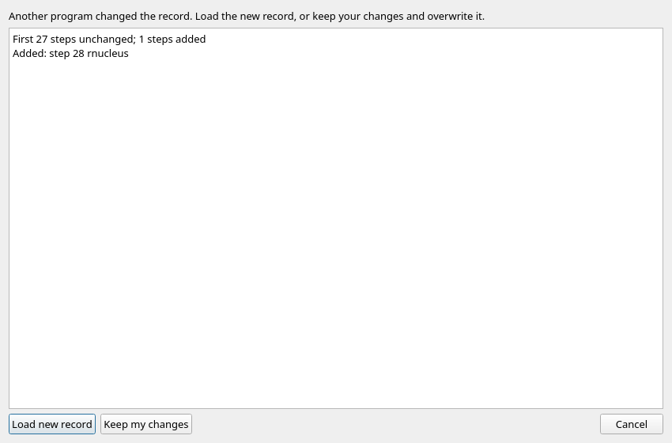
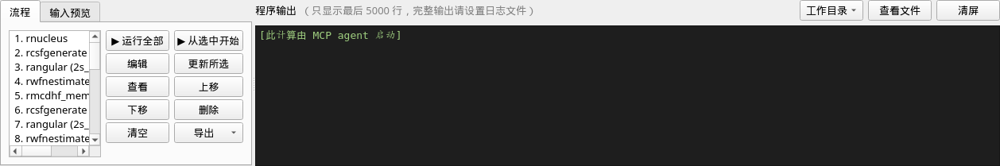
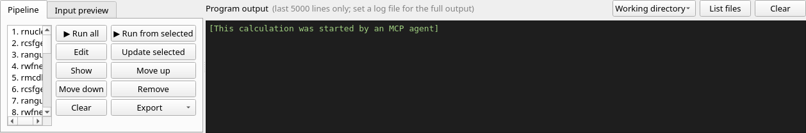

# MCP：本机与 SSH / Local and SSH

MCP **默认关闭**。新安装和旧版本升级都不会自动打开。这里只提供不开窗口的服务，
不会操控已经打开的 GUI。源码命令中的 `python3 grasp_gui.py` 可以换成打包后的 `grasp_gui`。

MCP is **off by default**, including after an upgrade. This is a headless service; it does not control
an open GUI. Replace `python3 grasp_gui.py` below with the standalone `grasp_gui` executable when packaged.

## 打开与关闭 / Enable and disable

用户自己执行以下命令，或者勾选 GUI 的“设置 → 允许 AI agent 通过 MCP 使用本程序”。
勾选时显示能力说明和三种可以复制的客户端配置。开关保存在同一个用户设置文件
`~/.config/grasp_gui.json` 的 `mcp_enabled` 中；缺少该项等同于 `false`。
服务没有修改开关的工具。关闭后，新服务拒绝启动，现有服务的每次工具调用都会报错；
已经启动的后台计算继续运行，可在 GUI 中查看和停止。

Run these commands yourself, or use **Settings → Allow AI agents via MCP** in the GUI. Enabling in the GUI
shows an explanation and copyable client configurations. Both use `mcp_enabled` in
`~/.config/grasp_gui.json` (missing means `false`). There is no tool for enabling the service. Disabling
rejects new servers and subsequent tool calls; existing background calculations continue and can be
viewed or stopped from the GUI.

```sh
python3 grasp_gui.py mcp --enable
python3 grasp_gui.py mcp --disable
```

## Agent 须知 / Instructions for agents

是否打开 MCP、是否允许自定义命令，均由用户本人决定。Agent 不得：

- 执行 `mcp --enable`，包括通过自己的 shell 工具代为执行；
- 修改用户设置中的 `mcp_enabled`；
- 自行给服务或客户端配置添加 `--allow-custom`。

服务关闭或拒绝自定义命令时，应告知用户，由用户自己决定并操作。用户若选择允许自定义命令，
应自行在客户端的服务启动参数中添加 `--allow-custom`。

Enabling MCP and allowing custom commands are decisions for the user alone. Agents must not:

- Execute `mcp --enable`, including through their own shell tools.
- Change `mcp_enabled` in the user's settings.
- Add `--allow-custom` to the service invocation or client configuration themselves.

When the service is disabled or custom commands are refused, inform the user and leave the decision and
action to them. A user who chooses to allow custom commands adds `--allow-custom` to the server arguments
in their client configuration themselves.

## 本机客户端 / Local clients

先打开开关，再用 `--print-config` 生成适合当前安装位置的配置。输出带当前可执行文件的绝对路径
(源码版还带 Python 路径) 和 `--root`；此命令在关闭时也可用，不会启动或打开服务。
默认根目录是 `~/grasp_calcs`。GUI 说明采用同一生成函数，使用默认根目录。

Enable first, then generate a configuration for your installation. `--print-config` includes the absolute
executable (and Python interpreter for source installations) and the selected root. It works while
disabled without enabling or starting a server. The default root is `~/grasp_calcs`; the GUI explanation
uses the same generator with that default root.

```sh
python3 grasp_gui.py mcp --root ~/grasp_calcs --print-config claude
python3 grasp_gui.py mcp --root ~/grasp_calcs --print-config codex
python3 grasp_gui.py mcp --root ~/grasp_calcs --print-config gemini
```

- **Claude Code**：执行打印出的 `claude mcp add grasp --scope user --transport stdio -- …`。
  Run the printed registration command.
- **Codex CLI**：将打印的 `[mcp_servers.grasp]` TOML 段放入 `~/.codex/config.toml`。
  Put the printed TOML section in that file.
- **Gemini CLI**：将打印的 `mcpServers.grasp` 对象合入 `~/.gemini/settings.json`，保留其他设置。
  Merge the printed object into that JSON file, preserving other settings.

命令行配置依据：[Claude Code](https://code.claude.com/docs/en/mcp)、
[Codex](https://developers.openai.com/codex/mcp)、
[Gemini CLI](https://geminicli.com/docs/tools/mcp-server/)。
These are the official client configuration references.

## 经 SSH 连接 / Connect over SSH

先在服务器上运行 `grasp_gui mcp --enable`。SSH 必须能用密钥或 ssh-agent 免交互登录；
不要分配终端 (`-T`)，远端登录脚本不能向标准输出打印欢迎文字。stdio 经 SSH 传输，
MCP 不开监听端口，也不需要 SSH 的端口转发。服务器路径及根目录使用服务器上的绝对路径。

Enable MCP **on the server** first. SSH must authenticate non-interactively using a key or ssh-agent.
Use `-T`; remote startup files must not print greetings to stdout. SSH carries stdio directly; MCP opens
no listening port and needs no SSH port forwarding. Use absolute paths on the server.

```sh
ssh myserver /opt/grasp/grasp_gui mcp --enable
claude mcp add grasp-server --scope user --transport stdio -- \
  ssh -T -o BatchMode=yes myserver /opt/grasp/grasp_gui mcp --root /srv/grasp-calcs
```

Codex 用下面的段；Gemini 的 `mcpServers` 也可使用同样的 `command` 和 `args`。
For Codex use this section; Gemini's `mcpServers` accepts the same command and arguments.

```toml
[mcp_servers.grasp_server]
command = "ssh"
args = ["-T", "-o", "BatchMode=yes", "myserver", "/opt/grasp/grasp_gui", "mcp", "--root", "/srv/grasp-calcs"]
```

## Inspector 调试 / Debug with Inspector

安装了 Node.js 的机器可以使用官方 [MCP Inspector](https://modelcontextprotocol.io/docs/tools/inspector)。
它是独立的调试客户端，不是本程序的依赖。服务的标准输出只包含逐行 JSON-RPC；诊断使用标准错误。
The official Inspector is an external debugging client, not an application dependency. Server stdout is
reserved for newline-delimited JSON-RPC; diagnostics use stderr.

```sh
npx @modelcontextprotocol/inspector --cli \
  python3 /opt/grasp-gui/grasp_gui.py mcp --root /srv/grasp-calcs --method tools/list
npx @modelcontextprotocol/inspector --cli \
  python3 /opt/grasp-gui/grasp_gui.py mcp --root /srv/grasp-calcs \
  --method tools/call --tool-name list_examples
npx @modelcontextprotocol/inspector --cli \
  ssh -T -o BatchMode=yes myserver /opt/grasp/grasp_gui mcp --root /srv/grasp-calcs \
  --method tools/call --tool-name get_pipeline --tool-arg directory=example1
```

## 工具 / Tools

参数使用 JSON 对象。`directory` 是相对于 `--root` 的工作目录，也可为根目录内的绝对路径。
`config` 是完整的[共享配置](CONFIG_FORMAT.md)，`example` 是 `list_examples` 中的 id。
`files` 是相对于工作目录的文件名数组 (最多 100 个)；省略时自动查找。
`limit` 默认 200、最大 1000。能量单位为 Hartree，波长为 Å，A 为 s⁻¹；原子轨道采用原子单位。

Arguments are JSON objects. `directory` is relative to `--root`, or an absolute path inside it. `config`
is a full [shared configuration](CONFIG_FORMAT.md); `example` is a bundled example id. `files` lists
filenames relative to the workdir (up to 100), with automatic discovery when omitted. `limit` defaults
to 200 and cannot exceed 1000. Energies are Hartree, wavelengths Å, A values s⁻¹; orbital properties use
atomic units.

| Tool | Arguments | Result / 结果 |
|---|---|---|
| `list_steps` | `{}` | 程序页 / Program pages |
| `describe_step` | `step` | 字段、默认值与提示 / Fields, defaults, hints |
| `list_examples` | `{}` | 标题、简介、时间 / Titles, summaries, runtimes |
| `validate_config` | `config` | 校验和警告 / Validation and warnings |
| `create_workdir` | `directory`, exactly one of `config` / `example` | 导入到新建或空目录 / Import into a new or empty directory |
| `get_pipeline` | `directory` | `config`, `revision` |
| `update_workdir` | `directory`, `revision`, `config` | 保留结果、更新记录，不运行 / Retain results, update without running |
| `export_script` | `directory`, optional `slurm` settings object | 有界脚本文本 / Bounded shell or Slurm text |
| `run` | `directory`, optional `start` (1-based), `force` (boolean, default false) | 预检后后台启动 / Preflight then start |
| `status` | `directory` | 后台状态 / Background state |
| `tail_log` | `directory`, optional `lines` (1–1000, default 100) | 有界日志 / Bounded log tail |
| `stop` | `directory` | 停止请求和确认 / Stop request and confirmation |
| `list_results` | `directory` | 按内容识别的文件 / Files identified by content |
| `levels` | `directory`, optional `files`, `limit`, `components` (0–20, default 3) | 能量、J、宇称、纯度、jj/LSJ / Energies, J, parity, purity, jj/LSJ |
| `transitions` | `directory`, optional `files`, `limit` | λ、A、gf、S、分支比 / Transition properties |
| `orbitals` | `directory`, optional `files`, `limit` | 轨道性质 / Orbital properties |
| `plot_levels` | `directory`, optional `files`, `limit`, `output` | PNG image; optional PNG/SVG/PDF file |
| `plot_wavefunctions` | `directory`, optional `files`, `output` | PNG image of up to 20 P(r) curves; optional PNG/SVG/PDF file |

`slurm` 使用 GUI 的同名设置：`job`, `partition`, `nodes`, `ntasks`, `time`, `mem`, `mail`,
`extra`, `modules`, `bindir`, `mpirun`, `mpitmp`；省略的项采用原有默认值。
`slurm` uses those GUI settings; omitted fields retain the existing defaults.

结构化结果同时放在 JSON 文本和 `structuredContent` 中 (2025-03-26 客户端只有 JSON 文本)。
工具失败返回 `isError: true`；不要把协议成功误认成计算成功。后台 `status: "ok"` 表示流程结束，
仍需检查输出文件和参考能量。日志和脚本文本上限 65536 字符，响应上限 8 MiB；有截断标志。
`transitions` 默认读 GUI 已计算的缓存，也可通过 `files` 指定 rtransition 输出；分支比只对当前
读取到的衰变通道求和，不能当作完整寿命。`output` 相对于工作目录，限制在根目录中。
无 Qt 时数值工具照常使用，绘图返回明确错误；绘图复用现有查看器，不启动 GUI 窗口。

Results include JSON text and `structuredContent` (JSON text only for 2025-03-26). Tool failures return
`isError: true`. A successful RPC is not proof of a successful calculation: `status: "ok"` means the
pipeline ended; check outputs and reference energies. Logs/scripts are capped at 65536 characters and
responses at 8 MiB, with truncation flags. Transitions default to GUI-computed caches; `files` can select
rtransition outputs. Branching ratios cover only the channels read, not a complete lifetime. `output`
is relative to the workdir and restricted to the root. Numerical tools work without Qt; drawing reports
an explicit error without it and otherwise reuses the viewers offscreen.

## 运行前检查 / Run preflight

`run` 使用与 GUI 相同的名称和文件预检，只检查 `start` 起实际运行的步骤。每页的 `validate` 是名称限制的
唯一依据；上游输出会沿 `inputs/outputs` 及复制动作关联，报告在哪一步生成了令后续步骤失败的派生名称。

- 名称超限或其他参数校验失败：拒绝启动，`force: true` 也不能跳过。
- 缺少输入文件：默认拒绝，只有显式传入布尔值 `force: true` 才允许启动；仍须由程序实际读到需要的文件。
- 未声明文件依赖的步骤列为 `skipped`，不据此声称安全或完整，也不单独阻止运行。
- 自定义命令权限、根目录限制和其他启动条件照常检查；`force` 不绕过这些限制。

拒绝的工具结果为 `isError: true`，JSON 文本和 (支持时的) `structuredContent` 同时含 `started: false`、
`issues`、`invalid`、`missing`、`skipped`。`issues` 按步号排序；`invalid` 为名称/参数问题，`missing` 为缺文件。
每个问题含 `kind` (`name` / `validation` / `missing`)、`step` (从 1 开始)、`program`、`reason`，以及：

- 名称：`field`、`name`、`limit`、`unit` (`characters` 或 `bytes`)；
- 派生名称：另有 `file` 和 `required_by: {step, program, field}`，原步骤的 `field` 给出影响输出名称的字段；`name/limit/unit` 属于下游名称校验，
  不表示生产程序自身新增了相同的限制；
- 缺文件：`file` 和 `similar` (相近文件名)。

例如问题列表中的一项 (省略其余条目；`reason` 随语言变化，程序应读取结构化字段而非解析提示文字)：

```json
{
  "kind": "name", "step": 2, "program": "jj2lsj", "field": "state",
  "name": "rn2_odd_cv6_low_corr_qed", "limit": 23, "unit": "characters",
  "reason": "jj2lsj 的态名称超出允许长度"
}
```

`validate_config` 也返回 `valid: false` 和结构化 `issues`，会报告派生名称；它不检查本机文件存在性，
配置可能用于另一台服务器。其他配置结构错误仍按原方式返回工具错误。导入、更新和脚本生成仍严格校验，
不会因诊断接口允许汇总问题而放行无效配置。修正配置后应再次校验/运行，不要把协议响应当作运行成功。

Before `run`, the same checker as the GUI validates names/parameters and required files from the selected start.
Invalid names/parameters always block execution. Missing inputs block by default; only boolean `force: true`
permits a run despite them. It does not create those files or bypass custom-command permissions, root restrictions
or other startup checks. Undeclared dependencies are reported as `skipped`.

Rejected calls return `isError: true` with JSON/structured data containing `started: false`, sorted `issues`,
`invalid`, `missing` and `skipped`. Issues identify one-based step, program and reason. Name issues additionally
include field, name, limit and character/byte unit. Derived-name issues identify the output file and its downstream
consumer in `required_by`; missing-file issues include similar filenames. Only the steps actually selected to run
are checked; skipped producers are not assumed to produce files.

`validate_config` returns `valid: false` and structured `issues` for name/parameter problems, including derived
names. It does not check whether inputs exist locally. Other structural errors retain normal tool-error handling;
import/update/script generation remain strict. Correct the configuration before retrying.

## 并发修改 / Concurrent edits

先 `get_pipeline`，修改返回的 `config`，再用同一次读取的 `revision` 调用 `update_workdir`。
修订号是记录内容的 SHA-256，仅用于 RPC，不增加工作目录文件字段。文件若已被 GUI 或别的客户端修改，
写入被拒绝；重新读取后再决定如何改。更新保留结果，已有输入文件冲突时保留原文件并报告；需要覆盖时
在 GUI 的更新预览中明确选择。新增步骤不会自动运行，必须另外调用 `run`。

Read with `get_pipeline`, edit its `config`, and pass that read's `revision` to `update_workdir`. The
revision is the record's SHA-256, returned by RPC without adding session fields. A changed record causes
write rejection; read again before deciding how to edit. Updates retain results and report conflicting
input files while keeping their existing contents; choose overwrites explicitly in the GUI preview.
New steps never run automatically: call `run` separately.

GUI 在保存前和窗口重新获得焦点时检查外部修改，显示改动摘要。默认“载入新的记录”；“保留我的修改”
覆盖前还需确认。取消则不保存。所有本版本的记录写者共用用户配置目录中的锁，唯一临时文件加原子替换；
旧版或其他程序若不使用该锁，仍应避免同时写。已有记录和共享配置的格式保持不变。

The GUI checks before saving and when regaining focus, displaying a change summary. Loading the new
record is the default; keeping local changes requires a second overwrite confirmation. Cancel leaves
the file untouched. Writers in this version share per-directory locks under the user configuration
directory and use unique temporary files plus atomic replacement. Avoid simultaneous writes with older
versions or other programs that do not use these locks. Existing session/shared-config formats are retained.

GUI screenshots / 界面截图：

| | 中文 | English |
|---|---|---|
| 外部修改 / External change |  |  |
| 运行来源 / Run origin |  |  |

## 目录与命令限制 / Directory and command limits

拒绝包含 `..` 的路径和真实目标在根目录外的符号链接。新建、更新、运行均拒绝自定义命令，除非
用户启动时明确加 `--allow-custom`。运行复用现有后台进程和排他锁，同一目录不能同时运行两次。
运行设置 (bin、MPI、nice) 与 GUI 共用，GRASP 可用 `GRASP_BINDIR` 指定。运行状态添加可选
`started_by: "mcp"`；GUI 在 MCP 打开时显示来源，旧状态缺少该字段时按原行为处理。

Paths containing `..` and symlinks resolving outside the root are rejected. Creating, updating or running
custom-command pipelines requires an explicit `--allow-custom` on startup. Runs reuse the existing
background process and exclusion lock. Bin/MPI/nice settings are shared with the GUI; `GRASP_BINDIR`
selects the GRASP installation. Run state adds optional `started_by: "mcp"`; the GUI shows the origin
while MCP is enabled, and old states retain their existing behavior.

根目录限制服务的文件操作，**不是操作系统沙箱**。GRASP 程序和显式允许的自定义命令以当前用户权限运行；
不要授权不信任的客户端或配置。需要更强隔离时用受限账户或容器。
The root restricts service file operations; it is **not an OS sandbox**. GRASP programs and explicitly
allowed custom commands run with the user's permissions. Use trusted clients/configurations; use a
restricted account or container for stronger isolation.

## 协议 / Protocol

实现 [MCP 2025-11-25](https://modelcontextprotocol.io/specification/2025-11-25)，兼容
2025-06-18 与 2025-03-26。方法为 `initialize`、`notifications/initialized`、`ping`、
`tools/list`、`tools/call`。无 HTTP、资源、提示模板、订阅或 GUI 控制；工具清单不分页。
The newline-delimited stdio server supports those protocol versions and methods. It does not provide
HTTP, resources, prompts, subscriptions or GUI control. The fixed tool list needs no pagination.
